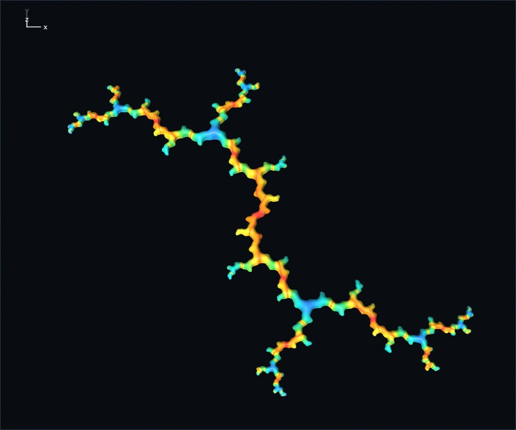
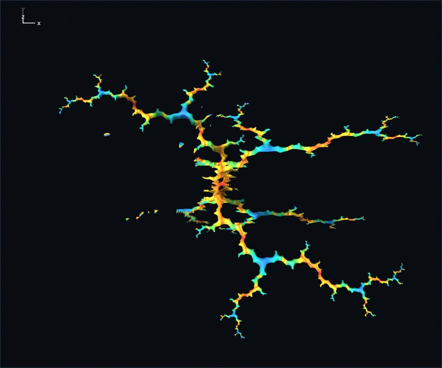
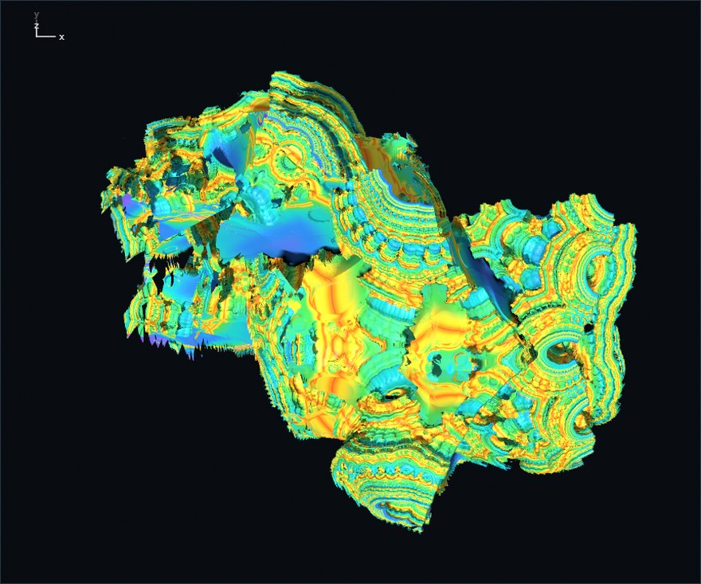

# The 3D fractal we are after

This file says what the 3D Mandelbrot and Julia sets should look like, how a rule is judged, what has come
closest, and what is known not to work. Lines in quote marks are the words the goal was put in, kept as written.

Names used below are the names in the lab's Approach list. Three shorthands come up often:
"one plane" is *Sphere inversions, one plane*, "two planes" is *Sphere inversions, two planes*, and
"the cousin" is *Balls on balls*.

## In short

Take the flat rule z → z² + c and carry it into space with plain 3D points, so that:

- the cut through the middle is exactly the flat picture;
- where the flat picture has an inside, the solid has a full, rounded body;
- whatever shapes the flat picture has along its edge show in 3D the same way: on every body, in every
  direction, with the spacing and the shapes they have in the flat picture;
- nothing is creased, stretched, squeezed or smeared;
- it works for every Julia set (basilica, rabbit, dendrite, Kokopelli, ...) and then for the Mandelbrot set;
- the rule comes from the flat rule by itself, with nothing chosen by hand.

The shapes are not always bulbs.

> "not every fractal has bulb shaped things, like whatever shape in 2d, whether bulb or something else, should
> be the same in 3d. We only cared about bulbs because our first test was the basilica fractal."

Many of the quotes below say "bulbs" for that reason. Read it as: whatever the flat picture has there.

No rule found so far does all of this. The plain sphere-inversion rule gets halfway, and others each add a part:

> "We got halfway there with the normal sphere inversion approach, and then partially there with the other
> approaches I mentioned."

## The picture

**The starting point.**

> "it feels weird to me that no analog of the 2d mandelbrot has been made in 3d (i know about quaternions and how
> complex numbers only increase by 2 dimensions at a time, so not talking about that). What I want to do is
> identify the properties of what happens in 2d, and see how it happens in 3d with 3d vectors"

The lead was Kučera's paper, which builds 3D Julia sets out of sphere inversions and "seems to identify an
intriguing pattern between 3d klein sets and how we imagine the "true" 3d julia sets to look like":

> "I'm not a mathematician or care about the process, as long as it's elegant, repeatable with different
> equations, etc., but I'd love to extend what he imagines a 3d julia to look like into the mandelbrot"

**The middle cut is the flat picture.**

> "whatever approach you use, the z=0 case should be identical to the 2d case."

> "if circle inversions can create the mandelbrot, it's odd to me that sphere inversions can't create a shape
> that at z=0 - which is a slice that is a circle - will create the Mandelbrot shape."

**It happens everywhere in space, not only in a plane.**

> "it's off to me that extending what happens in 2d into 3d only makes it happen in the 2d plane, is there no
> analog quaternion operation that applies everywhere for 3d rotations/inversions?"

**Nothing is chosen. The power (the 2 in z²) decides how many of each shape there are,** as it does in the flat
picture. A dial for a "number of planes" must not.

> "the number of planes should not decide the inherent geometry of the fractal in 3d. It should be some
> representation of what is happening in the 2d mandelbrot - with respect to what happens hidden in the 3d -
> extended to 3d (with respect to what happens hidden in the 4d), and it shouldn't look like any of the other
> approaches of disconnected stuff and wrong z=0 and simply rotating the fractal around the x-axis"

**Full bodies, with the flat picture's shapes all over them.**

> "the sphere inversion's blown up shapes look intuitive, like the 2d slices' "inside" parts we would assume as
> having some 3d analog of it, with bulbs (or whatever feature that fractal has [...]) on it not just on the
> axis planes but everywhere in the same pattern, like the 2d spacing being done in 3d, not being stretched or
> warped or whatever."

> "we're looking for an inflated version of the 2d (so spherical inversions have to be involved somehow) but the
> bulbs occur all over those 3d surfaces naturally, not chosen. and quaterions I imagine have to be involved
> somehow, if not fully, so the resulting object is not stretched or otherwise revealing the limitations of 3d
> rotations"

A flat picture that is merely blown up, with nothing new off the flat plane, is "not what I want".

**The spread of the cousin, with the true shapes.** *Balls on balls* is not a Julia set. It has no c and its cut is
a chain of circles. But where its bodies sit, and how far apart, is the look:

> "that is (loosely, obviously the specific shapes are wrong but the placement and spacing of objects is pretty
> much perfect) exactly how I expect the 3d basilica to look. So this is what the 3d fractal should look like
> (with proper shapes obviously)"

The clearest statement of the target:

> "The distribution and overall structure of the cousin approach, paired with the correct shapes of the spherical
> inversion approach (at least with the basilica), is exactly (or, almost exactly - the exact distribution of the
> cousin approach is not necessarily the final solution, especially since it's arbitrary) what we're after."

**Every Julia set, not only the basilica.**

> "Note that it needs to work for any Julia, not just this one"

Rabbits made by other 3D rules "tend to look like these weird un-rabbity shapes, rather than recognizable bulbs
and insides". A 3D rabbit should read as a rabbit. A dendrite or Kokopelli should read as a 3D version of the flat
fractal. What the 3D form of a twig or a dust should be is open: "I can't imagine what their 3d analog would
look like besides a blown up 2d version which is not what I want".

## Where the rule may hide

Four hunches, none of them settled.

**The turn at each step.**

> "I imagine the secret lies in how we rotate the orbit at each iteration, not all these weird fake operations"

The flat rule does one thing to a point at each step: it turns it and stretches it. The rules that came closest
all add something on top of the one-plane rule: a fold, a mirror, a blend. The answer may need no such addition,
only the right turn.

**The hidden axis.** Turning in the plane is turning about an axis the plane does not have:

> "Consider the 1d case: how does a line rotate about the origin? well, it would appear to just flip back and
> forth on the number line about the origin, but we can interpret what's really happening as it rotating about
> some hidden axis, passing through some hidden space to go from one side to another. This can be extended into
> the 2d case, right? hidden axis, hidden space, etc. [...] and then, same for the 3d case"

So the 3D rule may be what the flat rule becomes when its hidden axis is counted, one dimension up.

**Every turn at once.** In space a point can be reached from the x-axis by many turns, not one.

> "if picking a single rotation is what causes the artifacts we don't want, what then prevents rotating along all
> axes of rotation and somehow deciding from there?"

Nothing prevents it. What it gives is under "A turn chosen for each point" below: the deciding is the whole
question.

**Back from the Kleinian side.** The paper goes from squaring to sphere inversions. The cousin is made of sphere
inversions and already has the look.

> "If we have a Klein approach, can't we do the reverse of the kucera math (or any other math you know, or you
> discover new math) identify how sphere inversions lead to it?"

**A doubt about mirrors.**

> "idk if mirrors (or at least how I imagine it, like an arbitrary selection or mirroring something) is the right
> approach."

## How a rule is judged

By eye, in the lab, on pictures and sliders. A rule has to pass all of these:

1. **Exact cut.** The cut at z = 0 is the flat picture, exactly.
2. **Count from the power.** How many of each shape there are follows the power, as in the flat picture. No dial
   sets it.
3. **Whole.** No shards, no loose pieces, no tears.
4. **Not spun.** It is not the flat picture turned round a line (rings), and not a blown-up flat picture with
   nothing off the plane.
5. **All over.** The flat picture's shapes cover the bodies in every direction, spread much as on *Balls on
   balls*. Its exact spread is not required.
6. **Proper shapes.** Each has the shape it has in the flat picture: no crease, no hard edge, no stretch, no
   smear, at every size and at higher powers too.
7. **Every c.** The same rule, untouched, works for the whole panel of Julia sets.
8. **Principled.** It follows from the flat rule. Nothing is picked, placed or tuned by hand. The same carry-over
   works for other flat equations, not only z² + c.

Order of testing: the basilica first, then a panel of Julia sets ("like dendrite and basilica, and perhaps a few
more"; the lab's list also has the Douady rabbit, Kokopelli, San Marco and the airplane), then the Mandelbrot set,
then higher powers. A rule that fails one set is not an answer.

## The closest so far

All of these were judged first on the basilica, whose shapes are bulbs. In the quotes here "1d" means one plane
and "2d" means two planes.

| Rule in the lab | What is right | What is wrong |
| --- | --- | --- |
| Sphere inversions, one plane | Halfway. Exact cut. Full, rounded bodies: "the 1d inflation is great". Whole for every c. | Nothing new off the flat plane. |
| Sphere inversions, two planes | Bulbs in two planes, with proper shapes. The paper's basilica. | Creases and hard edges between the planes. Bulbs only in the planes. Whole only for c on the x-axis. |
| Turning plane, along | The best spread before the cousin: "bulbs growing between things in a natural way". | Bulbs are stretched and squeezed. |
| Sphere inversions, soft mirror | No crease: "it seems like there are no seams". | Whatever sits beside the mirror is stretched. Bulbs on a few circles only. |
| Soft mirrors, doubling | Bulbs between the planes, each big one ringed by smaller ones. | The borders between groups of bulbs look stretched. Whole only for c on the x-axis: the rabbit tears. |
| Sphere inversions, either side | Branches off the plane on the twig sets: "the fractals like the dendrite and kokopeli looked like 3d versions of the 2d fractal". | "less bulbs", and "the diagonal ones are smeared". Loose pieces: whole only for c on the x-axis. |
| Balls on balls | The spread: "pretty much perfect". | Not a Julia set. No c. Its placement is arbitrary. |

What is wanted lies "somewhere between" one plane and two planes: "the 1d inflation is great and the 2d
having bulbs everywhere is great, but the creases and hard edges of the 2d is not great, and the lack of any 3d
bulbs in the 1d approach is not great."

| | |
| --- | --- |
|  One plane: full bodies, nothing off the plane |  Two planes: proper bulbs in two planes, hard edges between them |
|  Turning plane, along: a good spread, stretched bulbs |  Soft mirrors, doubling: the closest basilica so far |
|  One plane on the dendrite: whole, but only the flat twig made thick |  Either side on the dendrite: branches off the plane too, with loose pieces |
|  Soft mirrors, doubling on the rabbit: torn | |

## What is ruled out

Each line closes one road. None of them shows that the goal cannot be reached, and whether it can be is still
open.

The first line rests on a theorem that has been proved. Everything else was worked out during the search and
checked against pictures. A rule named in italics is an entry in the lab. A result with no name comes from a
trial that is not in the lab. None of that has been checked by anyone else, so treat each of those lines as a
strong lead, not a proof.

- **One smooth formula cannot square and keep every shape in space.** Smooth means one formula for every point,
  with no jump and no kink. In the plane, squaring stretches a tiny shape by the same amount in every direction,
  so tiny shapes keep their shape. That is where the flat picture's clean detail comes from. In space the only
  moves that keep every tiny shape are turns, slides, mirrors, scalings and sphere inversions (turning space
  inside out through a sphere), and any of these done one after another. This is a theorem, proved by Liouville
  in 1850. Each of those moves can be undone, and squaring cannot: it sends two points to one. So a chain of
  those moves never squares, and a smooth formula that squares stretches somewhere. *One plane* shows it: it adds
  sphere inversions together instead of chaining them, which gives the exact cut and a squash off the flat plane.
  - What this closes: a smooth formula with no stretch at all.
  - What it does not close: a stretch that does not show. The tests are judged by eye, and the bodies of *one
    plane* were judged "great".
  - What it leaves open: a rule that uses different ones of those moves in different parts of space. The cousin
    is made that way, of slides and sphere inversions and nothing else, and keeps its detail in every direction.
  - What follows for a rule made that way: none of its parts can reach the flat plane with any width. A
    shape-keeping move of space that keeps the flat plane in place is fixed by what it does on that plane (up to
    swapping above and below), and there it is a shape-keeping move of the plane. Squaring is not one, on any
    patch. So the exact cut needs parts that get smaller without end towards the flat plane. The cousin's parts
    cross the plane at full width, which is why its cut is a chain of circles and not a flat Julia set.
- **Parts that each have a shape-keeping move, cut by a grid or by the orbit.** Space was cut into parts that get
  smaller towards the flat plane. Each part was moved by the shape-keeping move that fits the flat rule at the flat
  point under its middle: a turn and a scaling, or a Möbius move (one sphere inversion with a turn, a scaling and a
  slide), which fits the bend of the flat rule too. The flat cut is exact in all of them. Four ways of cutting
  were drawn on the basilica, the dendrite, the rabbit, Kokopelli and the Mandelbrot set:
  - Boxes on the grid that the power itself lays out, so that squaring carries the middle of a box onto the middle
    of a box. With the turn and the scaling (*Parts on a doubling grid, turn and scale*): low faceted shells and
    shards. With the Möbius move (*Parts on a doubling grid, Möbius*): full, round bodies, cut into plates along the
    walls of the boxes. In both, the dendrite and Kokopelli are lost almost entirely.
  - Boxes on a plain square grid, like the cousin's (*Parts on a square grid*): bodies built of blocks, and shards.
  - No grid: an orbit keeps the part it starts in (*Parts carried by the orbit*). No wall and no crack, and no top:
    the solid is the flat picture drawn straight up.
  - Parts of no size (*Parts of no size*): one smooth formula again. Full bodies close to balls, whole on all five
    sets, and nothing new off the flat plane.

  What they taught:
  - A wall is a jump or a mirror. Two shape-keeping moves that agree all along a wall are the same move, or one is
    the other behind a mirror in that wall. Two neighbouring fits of the flat rule are neither.
  - A jump shows as a crack unless the solid looks the same from both sides of it, which needs the two moves to
    differ by a move that leaves the solid as it is. The cousin is left as it is by every one of its own moves, and
    that is why its walls do not show. Every move tried here is carried up from the plane, so it keeps the flat
    plane in place, and so does the move by which two of them differ. A flat Julia set is left as it is by the half
    turn, and by a mirror when c is on the x-axis. No other such move is known for it.
  - Smaller parts close the cracks, because the jumps shrink faster than the parts do. But the jumps were the only
    thing that told one direction round the upright axis from another. Without them the rule is smooth and falls
    under the line on treating every direction alike, below.
  - A body gets its top from the fit being taken afresh at each step. A chain of shape-keeping moves fitted along
    one flat orbit keeps every height above the inside of the flat set.
  - What this does not close: parts whose moves do not keep the flat plane in place. The cousin has such a move,
    the slide square to its flat plane, and its bodies off the plane come from it: with the slide along the plane
    alone (its setting "A line only") the buds sit round the flat picture only.
- **One smooth rule of the plain kind is one plane.** Take any rule that squares the length and sends each
  direction to a new direction. The most such a rule can do is keep every shape on the sphere of directions, so
  that small circles there stay circles. If it does that and has the exact flat cut, it is *one plane* or its
  mirror twin. So shapes all over the bodies cannot come from a rule of that kind without giving something up.
- **The mirror twin.** Every rule has a twin: the same step, then up and down swapped (the modifier "flip z").
  The twin of *one plane* keeps the exact cut and keeps circles on the sphere of directions round, as *one plane*
  does, and its Mandelbrot solid stands taller. It has
  nothing new off the plane either.
- **A mirror plane either creases or smears.** A sharp mirror leaves a crease. A rounded one smears whatever sits
  on it, and something always sits on it: the mirror of one step is the plane that some smaller shape sits in at the next. Only the
  width of the damage can be chosen.
- **Mirror planes tear for most c.** A fold made of mirror planes that leaves the flat picture alone has to tear
  somewhere. The tear hides only when the flat picture is its own mirror image, which means c on the x-axis.
  This is why *two planes* and every mirror rule after it fail on the rabbit. The paper says the same of its own
  two-plane picture: "so far the second construction is unfortunately limited to c ∈ R" (page 444).
- **Adding mirror images instead of swapping them in** (*Sphere inversions, either side*): "less bulbs", and
  "the diagonal ones are smeared". Cross-fading the two sides of a mirror (*Blended mirrors, doubling*) puts a
  bubble round every bud on a mirror.
- **A plane taken from c** gives the flat picture spun round a line: rings. A plane that follows the orbit
  (*Pulled plane*) is "too simplistic": bulbs mirrored on two planes, and nothing between them.
- **Treating every direction round the upright axis alike** (the z-axis, which stands up out of the flat plane)
  adds nothing off the flat plane, or a smear, rings or shards. *Parts of no size* is one more rule of this kind.
  It raises the length to the power exactly and its bodies are close to balls, with nothing new on them.
- **Quaternions as they stand.** Squaring a quaternion and reading three of its four numbers spins the flat
  picture into rings (*Quaternion square (Lathe)*). Sphere inversions with no plane chosen give that same rule.
  Slices of the 4D sets, twisted copies and rotors (turns, as geometric algebra writes them) are in the lab and none has the flat picture's shapes all over.
  The quaternion square does not go round the sphere of directions twice, the way squaring goes round the circle
  twice. It covers it once forwards and once backwards, like a glove turned inside out, and the fold between the
  two is the plane it crushes.
- **A turn chosen for each point.** Squaring a flat point is doing one turn twice: the turn that carries the
  x-axis onto the point. In space many turns do that, and their axes make a full circle of directions.
  - All of them at once give a ring of answers round the point's own direction. Their average is that direction
    itself: no turn at all. Keeping every one treats all directions round the x-axis alike, so a set with c on
    the x-axis comes out the same all the way round that axis: rings.
  - So one has to be picked, and no way of picking is smooth for every direction. A sphere cannot be combed flat
    (the hairy ball theorem), and a smooth pick would comb it. The pick jumps or pinches somewhere.
  - Four picks are in the lab. The shortest turn is *Quaternion square (Lathe)*: rings. The turn that moves the
    upright axis least is *Rotor square with a frame*: a tear at the z-axis. The turn about the axis nearest to
    upright is *All axes, nearest to upright*: a whole plane crushed onto a line, and sheets and splinters. The
    turn about the axis nearest to the one the orbit used last is *All axes, nearest to the last one*: more
    splinters.
- **Changing the axis from step to step** (*Quaternion square, axis by step*) breaks the rings, but into one
  lumpy body with a swirled skin. One step of the quaternion square already crushes a whole plane flat, and no
  later step gives that back. A rule that changes by the step has to start from a step that crushes nothing.
- **The hidden axis, read as a turn in 4D.** To carry the x-axis to a point, the plane to turn in is the one that
  holds both. Doing that turn twice is the quaternion square again. 4D adds a second turn, in the plane square to that one, which holds the hidden axis.
  Making it count (*Quaternion square, twisted*) breaks the rings into one body with tunnels, but its skin is
  smooth sheets and folds.
- **Pillow grids.** The even spread of the cousin comes from sliding a pattern in two directions on a grid.
  Wrapping such a grid on the sphere and doubling it comes out better at odd powers. At power 2 it comes out
  lopsided (*Square pillow*) or spiky (*Even pillow*). A pillow with three corners gives one lump, or fibres
  (*Pillow*). Another, with one corner on the flat circle, gave lemon-shaped bodies. These grids are the one
  kind of rule found whose stretch does not build up from step to step. Mathematicians call such rules uniformly
  quasiregular, and Mayer (1997, "Uniformly quasiregular mappings of Lattès type") builds power rules of this
  kind for space. The paper has not been read closely for this search.
- **Stamping the cousin's bodies onto the true flat picture** gives needles wherever bodies meet.

## What may have to be let go

> "We're going to have to let go of some assumptions somehow to do this."

Almost every rule tried so far was built the same way, and the roads closed above are roads inside that way of
building. Each habit below was a natural place to start. For each: what is known while it is kept, and what
opens when it is dropped. A new attempt should name the habit it breaks. One that breaks none is most likely on
a road already closed.

1. **"Nothing is chosen", read as "nothing is told apart".** A rule that knows only the point and the x-axis
   has to treat every direction round the x-axis alike, and draws rings. A rule that knows only the point and the
   upright axis has to treat every direction round that axis alike, and adds nothing off the flat plane, or a
   smear, rings or shards. Bodies in many directions need something that tells directions apart round both axes. So the test cannot be
   that nothing is told apart. It is that whatever tells directions apart comes from the flat rule and not from
   a dial: the power, the orbit, c, or a grid as in the cousin.
2. **One formula with no jumps.** Kept, it stretches somewhere (the first line of "What is ruled out"). Dropped,
   each part of space can have its own shape-keeping move, as in the cousin. The price is known: the parts have
   to get smaller without end towards the flat plane. Dropped in the five *Parts* entries, with parts cut by a
   grid or by the orbit and moves carried up from the plane. What these taught: the walls show as cracks, and
   closing the cracks brings back one smooth formula. Not tried: parts whose moves do not keep the flat plane in
   place.
3. **The same rule at every step.** Dropped in *Along once, then one plane*, *Soft mirrors, doubling* and
   *Quaternion square, axis by step*. What these taught: a later step does not mend what an earlier step
   crushed, so every step has to be sound by itself.
4. **An orbit is a point and nothing else.** Dropped in *Pulled plane*, which carries a plane, and *All axes,
   nearest to the last one*, which carries an axis. Not tried: carrying the point before, so that a step works
   from two points, or carrying a size, so that a step moves a small ball and not a point.
5. **The length is squared and the direction goes to a direction**, so a sphere round the middle goes to a
   sphere round the middle. Nearly every rule in the lab does this. Inside it two cases stand out: keep circles
   on the sphere of directions round, and the rule is *one plane*; keep the stretch from building up, and the
   only rules found are the pillow grids. Dropped, length and direction mix, as they do in a sphere inversion about any other
   centre. In the flat rule only the middle point is special, and adding c moves it at once.
6. **Squaring is a turn done twice.** Squaring can be said in several ways. In the plane they all mean the same
   thing. In space they come apart, and each one that has been built on gave a different family in the lab:
   - the point times itself, which needs a way to multiply (the quaternion entries);
   - a turn done twice, with the length squared (the rotor entries, and the picks under "A turn chosen for each
     point");
   - every angle doubled (*Mandelbulb* and the other angle rules);
   - sphere inversions added up (the paper's reading: *one plane*, *two planes* and what grew from them);
   - doubling on a grid (the pillow entries);
   - the move that two points share: each point is reached from two points, its roots. This one has not been
     built on.
7. **A point has one next point.** Dropped once, in *Sphere inversions, either side*: two choices at a step, and
   a point is kept if any run of choices keeps it. Not tried: keeping a point only if every run keeps it, or
   running the rule backwards, where each point has two roots.
8. **The solid is the points that never get away.** Other ways to get a solid from a rule: where backward steps
   pile up, or what a set of moves leaves in place. The cousin is the second kind.
9. **The third direction is more of the same space**, with a height for the point and a height for c. Adding c
   as a 3D point is the lab's own choice. Not tried: reading the third direction as something the flat rule
   already has. One candidate is the size of a disc: every shape-keeping move of the plane has one partner in
   the space above it, which carries the dome over each disc to the dome over the disc's image. Another is the
   hidden axis itself.

## Open directions

Not tried, or not finished.

- **The turn at each step.** Rules that turn each point by something taken from the point or its orbit have been
  tried in several forms: *Turning plane, away* and *along*, *Wind, then square*, *Along once, then one plane*,
  *Pulled plane*, and the three entries built on the quaternion square: *Quaternion square, axis by step*, *All
  axes, nearest to upright* and *All axes, nearest to the last one*. *Turning plane, along* gave the best spread
  and stretched the shapes. The three built on the quaternion square failed outright, because their one step
  crushes a plane. Not found: a turn that the orbit itself picks at each step, built on a step that crushes
  nothing, whose stretch does not show. Each turn by itself stretches nothing. But if the turn changes from
  point to point with no jump, the rule as a whole is one smooth formula, and the first line of "What is ruled
  out" says it stretches somewhere. So what can be asked of such a turn is a stretch that does not show.
- **Back from the Kleinian side.** The cousin's recipe is already a rule applied over and over: slide by the
  nearest whole number of a grid, turn inside out in one of two spheres, repeat, and a point belongs if it never gets out.
  What it lacks is a c, and squaring: each of its moves can be undone, while squaring sends two points to one.
  Open: which change to that recipe brings in c and the two-to-one step without losing the look. In the plane
  this join has been made. Bullett and Penrose (1994, "Mating quadratic maps with the modular group") made rules
  that act as a squaring rule on one part of the plane and as a group of the Kleinian kind on the rest. Lee,
  Lyubich, Makarov and Mukherjee ("Schwarz reflections and the Tricorn") found rules that act as a mirrored
  squaring rule on one part of the plane and as a group of circle reflections on the other, the basilica among
  them. Mj and Mukherjee (2021, "Combining rational maps and Kleinian groups via orbit equivalence") set out
  when a squaring rule and a group of the Kleinian kind can be joined at all. None of the three has been read
  closely for this search, and whether any of it carries over to spheres is open.
- **Mirror spheres that stay clear of the flat plane.** These are the one kind of fold that keeps every shape and
  never tears, for any c. The cousin is made of sphere inversions too, but its spheres sit across the flat plane.
  Spheres round two poles above and below the middle put bodies all over every set, dendrite and Kokopelli
  included, but they came out ribbed and lumpy, and the height of the poles had to be set by hand for each set.
  That rule is not in the lab. Where the spheres should sit, and what in the flat rule would place them, is open.
- **The set's own spine.** The doubling mirrors turn about the x-axis, which is the basilica's own line of
  symmetry. Every Julia set has a line of its own through the middle and a fixed point (a point the rule leaves
  where it is), though for most sets it is not a line of symmetry. Turning the mirrors about that line has not
  been tried.
- **Working backwards.** A flat Julia set can also be drawn backwards: take any point, undo one step of the rule
  (take away c, then take either of the two square roots), and repeat. The points pile up on the edge of the
  set. A 3D rule built from roots, with more than two of them spread over the sphere, has not been tried.
- **The hidden axis, read another way.** It has been tried only through quaternions. Other ways of counting the
  hidden direction have not.

## Where things are

- `squaring-lab.html` is the lab. Every rule named above is an entry in its Approach list, with its own texts and,
  where it has any, its own dials. Some of the rules that failed are grouped there under "Tried, and failed".
- *Balls on balls* is under the Kleinian tab.
- The Learn tab plays one step of any rule, move by move, for a point or for a whole shape.
- The button "Custom approach" under the Approach list opens a rule that is put together on the page, step by
  step, from the same pieces the rules above are made of. It is the place to try a new idea before it is written
  as an entry.
- Each rule is one entry in `src/js/10-approaches.js`: its shader text, the same rule in JavaScript, and its
  texts. A new rule is a new entry, never a dial setting of an old one.
