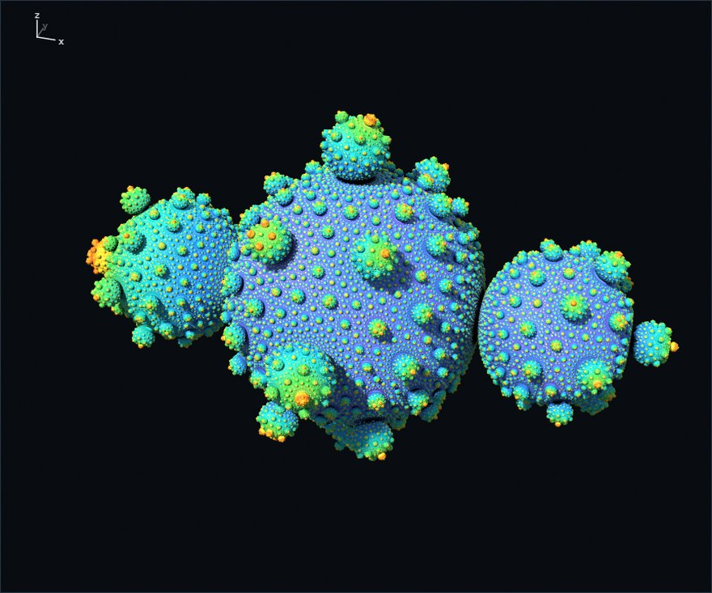
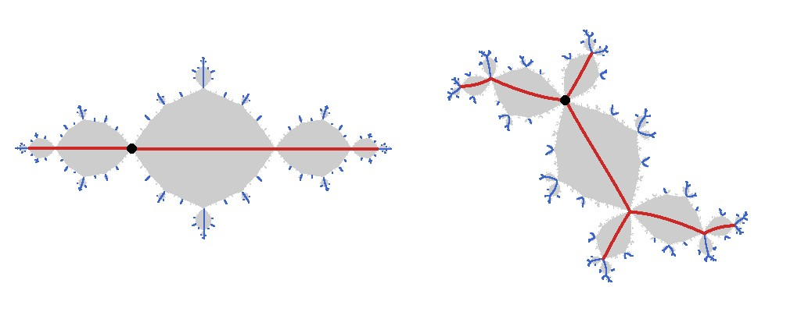
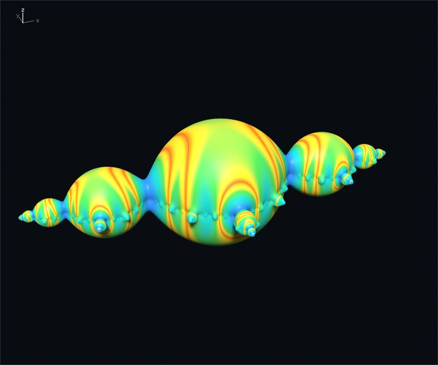
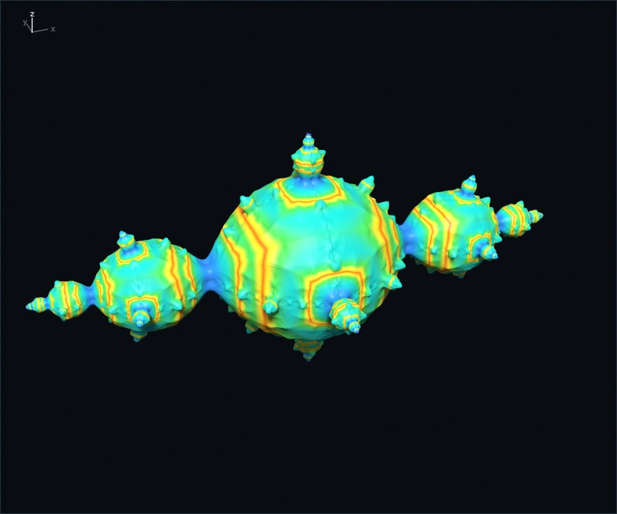
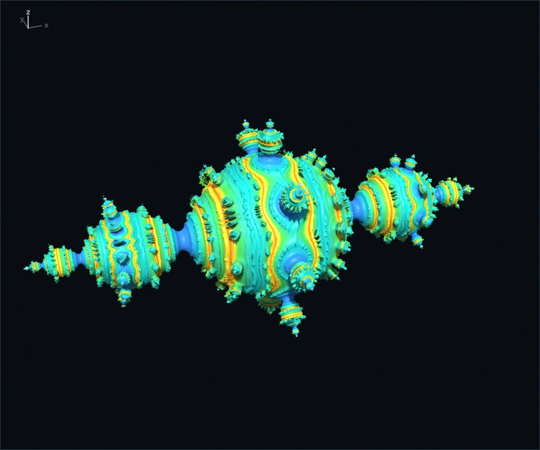
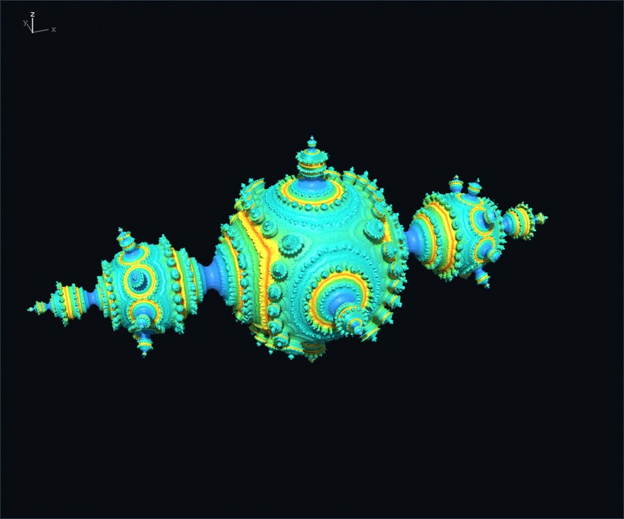

# The 3D fractal we are after

This file says what the 3D Mandelbrot and Julia sets should look like, how a rule is judged, what has come
closest, and what is known not to work. Lines in quote marks are the words the goal was put in, kept as written.

Names used below are the names in the lab's Approach list. Three shorthands come up often:
"one plane" is *Sphere inversions, one plane*, "two planes" is *Sphere inversions, two planes*, and
"the cousin" is *Balls on balls*.

## In short

Take the flat rule z → z² + c and carry it into space with plain 3D points, so that:

- the cut through the middle is exactly the flat picture;
- where the flat picture has an inside, the solid has a full, rounded body;
- whatever shapes the flat picture has along its edge show in 3D the same way: on every body, in every
  direction, with the spacing and the shapes they have in the flat picture;
- nothing is creased, stretched, squeezed or smeared;
- it works for every Julia set (basilica, rabbit, dendrite, Kokopelli, ...) and then for the Mandelbrot set;
- the rule comes from the flat rule by itself, with nothing chosen by hand.

The shapes are not always bulbs.

> "not every fractal has bulb shaped things, like whatever shape in 2d, whether bulb or something else, should
> be the same in 3d. We only cared about bulbs because our first test was the basilica fractal."

Many of the quotes below say "bulbs" for that reason. Read it as: whatever the flat picture has there.

No rule found so far does all of this. The plain sphere-inversion rule gets halfway, and others each add a part:

> "We got halfway there with the normal sphere inversion approach, and then partially there with the other
> approaches I mentioned."

## The picture

**The starting point.**

> "it feels weird to me that no analog of the 2d mandelbrot has been made in 3d (i know about quaternions and how
> complex numbers only increase by 2 dimensions at a time, so not talking about that). What I want to do is
> identify the properties of what happens in 2d, and see how it happens in 3d with 3d vectors"

The lead was Kučera's paper, which builds 3D Julia sets out of sphere inversions and "seems to identify an
intriguing pattern between 3d klein sets and how we imagine the "true" 3d julia sets to look like":

> "I'm not a mathematician or care about the process, as long as it's elegant, repeatable with different
> equations, etc., but I'd love to extend what he imagines a 3d julia to look like into the mandelbrot"

**The middle cut is the flat picture.**

> "whatever approach you use, the z=0 case should be identical to the 2d case."

> "if circle inversions can create the mandelbrot, it's odd to me that sphere inversions can't create a shape
> that at z=0 - which is a slice that is a circle - will create the Mandelbrot shape."

**It happens everywhere in space, not only in a plane.**

> "it's off to me that extending what happens in 2d into 3d only makes it happen in the 2d plane, is there no
> analog quaternion operation that applies everywhere for 3d rotations/inversions?"

**Nothing is chosen. The power (the 2 in z²) decides how many of each shape there are,** as it does in the flat
picture. A dial for a "number of planes" must not.

> "the number of planes should not decide the inherent geometry of the fractal in 3d. It should be some
> representation of what is happening in the 2d mandelbrot - with respect to what happens hidden in the 3d -
> extended to 3d (with respect to what happens hidden in the 4d), and it shouldn't look like any of the other
> approaches of disconnected stuff and wrong z=0 and simply rotating the fractal around the x-axis"

**Full bodies, with the flat picture's shapes all over them.**

> "the sphere inversion's blown up shapes look intuitive, like the 2d slices' "inside" parts we would assume as
> having some 3d analog of it, with bulbs (or whatever feature that fractal has [...]) on it not just on the
> axis planes but everywhere in the same pattern, like the 2d spacing being done in 3d, not being stretched or
> warped or whatever."

> "we're looking for an inflated version of the 2d (so spherical inversions have to be involved somehow) but the
> bulbs occur all over those 3d surfaces naturally, not chosen. and quaterions I imagine have to be involved
> somehow, if not fully, so the resulting object is not stretched or otherwise revealing the limitations of 3d
> rotations"

> "we want to inflate the 2d fractals according to their shapes, such that the surfaces of the 3d equivalents has
> the same recognizable (not-stretched) pattern all over it, not just at the z=0 plane"

A flat picture that is merely blown up, with nothing new off the flat plane, is "not what I want".

**The spread of the cousin, with the true shapes.** *Balls on balls* is not a Julia set. It has no c and its cut is
a chain of circles. But where its bodies sit, and how far apart, is the look:

> "that is (loosely, obviously the specific shapes are wrong but the placement and spacing of objects is pretty
> much perfect) exactly how I expect the 3d basilica to look. So this is what the 3d fractal should look like
> (with proper shapes obviously)"

The clearest statement of the target:

> "The distribution and overall structure of the cousin approach, paired with the correct shapes of the spherical
> inversion approach (at least with the basilica), is exactly (or, almost exactly - the exact distribution of the
> cousin approach is not necessarily the final solution, especially since it's arbitrary) what we're after."

**Every Julia set, not only the basilica.**

> "Note that it needs to work for any Julia, not just this one"

Rabbits made by other 3D rules "tend to look like these weird un-rabbity shapes, rather than recognizable bulbs
and insides". A 3D rabbit should read as a rabbit. A dendrite or Kokopelli should read as a 3D version of the flat
fractal. What the 3D form of a twig or a dust should be is open: "I can't imagine what their 3d analog would
look like besides a blown up 2d version which is not what I want".

## Where the rule may hide

Six hunches, none of them settled.

**The turn at each step.**

> "I imagine the secret lies in how we rotate the orbit at each iteration, not all these weird fake operations"

The flat rule does one thing to a point at each step: it turns it and stretches it. The rules that came closest
all add something on top of the one-plane rule: a fold, a mirror, a blend. The answer may need no such addition,
only the right turn.

**The hidden axis.** Turning in the plane is turning about an axis the plane does not have:

> "Consider the 1d case: how does a line rotate about the origin? well, it would appear to just flip back and
> forth on the number line about the origin, but we can interpret what's really happening as it rotating about
> some hidden axis, passing through some hidden space to go from one side to another. This can be extended into
> the 2d case, right? hidden axis, hidden space, etc. [...] and then, same for the 3d case"

So the 3D rule may be what the flat rule becomes when its hidden axis is counted, one dimension up.

**Every turn at once.** In space a point can be reached from the x-axis by many turns, not one.

> "if picking a single rotation is what causes the artifacts we don't want, what then prevents rotating along all
> axes of rotation and somehow deciding from there?"

Nothing prevents it. What it gives is under "A turn chosen for each point" below: the deciding is the whole
question.

**Back from the Kleinian side.** The paper goes from squaring to sphere inversions. The cousin is made of sphere
inversions and already has the look.

> "If we have a Klein approach, can't we do the reverse of the kucera math (or any other math you know, or you
> discover new math) identify how sphere inversions lead to it?"

**A doubt about mirrors.**

> "idk if mirrors (or at least how I imagine it, like an arbitrary selection or mirroring something) is the right
> approach."

**A second plane that follows the set.** For the basilica the upright plane through the x-axis should show the
flat picture as well: one plane "is not quite right, because the xz plane should match the xy plane (at least in
the power 2 case". But the x-axis is the basilica's own line and not every set's:

> "the xy plane being the same as the xz plane in the basilica case is just a unique property of the basilica,
> because it's symmetrical along the x axis while the douady rabbit isn't - which exposes something about how
> reflections should be working here, it's not really about a specific axis but following the natural shape of
> the fractal somehow"

> "how can we jump from 1d to 2d, without folding (to avoid creases) and doing it such that it properly follows
> the emergent symmetry of the fractal? Or, if that's too hard and there is no creaseless fold-equivalent
> operation and we have to fold, can we get the rest of the things we're looking for?"

Shapes all over the surface "would be the next step after this".

**The second axis follows the set, and need not be straight.** The problem, set again as one problem at power 2:

> "let's inflate the julias properly, like the 1d spherical inversion does, but in bulbs appearing on both axes (I
> don't mean the xy and xz planes, as in the basilica - I mean the z=0 plane and whatever is at the peak of the
> inflations, however the fractal is shaped - actually that second axis is hard to describe, as it doesn't have
> to be straight or flat since the fractal doesn't have to have symmetry along a single line - it just so happens
> that the basilica is symmetrical across the x-axis"

> "This might actually be the source of our problem, like what is that second axis? what is it supposed to look
> like for the douady rabbit?"

And a clue, from the upright cut of the rabbit under *two planes*, which shows half a rabbit and its mirror image:
"I wonder if that's our first clue - the top half of that needs to be mirrored?"

One answer to "what is that second axis": every body has a line of its own. It runs through the middle of the
body, from the point where the body hangs on its parent to the point opposite, and the flat rule lays each such
line onto another one. For the basilica the lines of the big bodies make up the x-axis, and each small bulb has
its own, pointing away from the body it sits on. For the rabbit the lines bend, and three of them meet at each
pinch point where three bodies meet. An upright wall standing on those lines is where the peaks of the inflated
bodies lie.

Red: the lines of the big bodies. Blue: the lines of smaller ones. Asked whether these are the second axis that
was meant: "Yes, those lines".

**How many bulbs spring from a pinch point.** A thought set down for later, with the simplest case to come first:

> "see how the rabbit has 2 bulbs spawning from each point? in 2d it's known that it's 2, and in 3d one option is
> to keep that. but a second option could be to double it, and make it 4 bulbs that spawn from a fixed point - 2
> higher and 2 lower (at least in the period 2 bulbs, the other ones would just keep the same relative pattern
> respective to their orientation). I suppose this allows a third option of n bulbs, so like n=3 would be that 6
> bulbs spawn from that point, etc. But I imagine n=1 is the simplest approach, so let's start with whichever's
> simplest."

Only n = 1 keeps the exact cut, and for n above 1 that is allowed:

> "anything other than n=1 will violate the z=0 equivalency we're after, even though the n=2+ options would still
> produce recognizable fractals. and this is not forced btw - like in the basilica case, there's only one bulb
> for each fixed point, so n=2+ would just look identical to the n=1 case. This is the one time the z=0
> violation is fine. again, only worry about this when it is relevant"

## How a rule is judged

By eye, in the lab, on pictures and sliders. A rule has to pass all of these:

1. **Exact cut.** The cut at z = 0 is the flat picture, exactly.
2. **Count from the power.** How many of each shape there are follows the power, as in the flat picture. No dial
   sets it.
3. **Whole.** No shards, no loose pieces, no tears.
4. **Not spun.** It is not the flat picture turned round a line (rings), and not a blown-up flat picture with
   nothing off the plane.
5. **All over.** The flat picture's shapes cover the bodies in every direction, spread much as on *Balls on
   balls*. Its exact spread is not required.
6. **Proper shapes.** Each has the shape it has in the flat picture: no crease, no hard edge, no stretch, no
   smear, at every size and at higher powers too.
7. **Every c.** The same rule, untouched, works for the whole panel of Julia sets.
8. **Principled.** It follows from the flat rule. Nothing is picked, placed or tuned by hand. The same carry-over
   works for other flat equations, not only z² + c.

Order of testing: the basilica first, then a panel of Julia sets ("like dendrite and basilica, and perhaps a few
more"; the lab's list also has the Douady rabbit, Kokopelli, San Marco and the airplane), then the Mandelbrot set,
then higher powers. A rule that fails one set is not an answer. Until power 2 is solved the work stays on power 2:
"ignore that power 3+ stuff, as I said, just power 2. ok let's solve one problem at a time."

## The closest so far

All of these were judged first on the basilica, whose shapes are bulbs. In the quotes here "1d" means one plane
and "2d" means two planes.

| Rule in the lab | What is right | What is wrong |
| --- | --- | --- |
| Sphere inversions, one plane | Halfway. Exact cut. Full, rounded bodies: "the 1d inflation is great". Whole for every c. | Nothing new off the flat plane. "not quite right, because the xz plane should match the xy plane". |
| Sphere inversions, two planes | Bulbs in two planes, with proper shapes. The paper's basilica. The upright plane matches the flat one "as expected". | Creases and hard edges between the planes. Bulbs only in the planes. Whole only for c on the x-axis: the rabbit "looks like a completely unrecognizable shape". |
| Pulled plane | On the basilica it "kind of does this": the upright plane shows the flat picture. | "the douady rabbit still looks like a 1d inflated object". |
| Even pillow | "goes a step further": it "has bulbs on the 3d surface". | "it's off in how the shapes manifest and the xz plane in the basilica doesn't match its xy plane". |
| Turning plane, along | The best spread before the cousin: "bulbs growing between things in a natural way". | Bulbs are stretched and squeezed. |
| Sphere inversions, soft mirror | No crease: "it seems like there are no seams". | Whatever sits beside the mirror is stretched. Bulbs on a few circles only. |
| Soft mirrors, doubling | Bulbs between the planes, each big one ringed by smaller ones. | The borders between groups of bulbs look stretched. Whole only for c on the x-axis: the rabbit tears. |
| Sphere inversions, either side | Branches off the plane on the twig sets: "the fractals like the dendrite and kokopeli looked like 3d versions of the 2d fractal". | "less bulbs", and "the diagonal ones are smeared". Loose pieces: whole only for c on the x-axis. |
| Four to one, two planes alike | On the basilica the upright plane shows the flat picture point for point, with no crease, no fold and no mirror. Four buds round each body. | Between the two planes the skin is ribbed, swirled and hairy. The rabbit, the dendrite and Kokopelli are shreds on a shell. |
| Four to one, caps flipped over | The dendrite and Kokopelli are trees in space, in one piece, with branches in every direction. The rabbit is one bushy piece with lobes off the plane. No crease, no fold, no mirror. | The basilica is one lump. Every skin is rough and spiky. |
| Four to one, caps placed by c | The basilica and San Marco are a row of bodies with one more above and one below the middle body. The dendrite and Kokopelli are trees in space, and the rabbit is one piece with bodies in several directions. | The rotation of c was fitted by hand. The basilica's two extra bodies lean to one side of the x-axis. A c below the x-axis gives a lump and not the mirror image, so the Mandelbrot solid is lopsided. The airplane is dust. Every skin is rough and striped. |
| Two planes, about every body's own line | The rabbit stays a rabbit, in one piece, with buds on the tops and the undersides of its bodies: "it certainly looks better than every other approach". The basilica as under *two planes*. | "there are these gaps in the fractal surface": cracks beside the pinch points at few iterations, and fine dark scratches all over the skin. Corners at 45 degrees round each line. The reach is a number picked by eye. Julia sets only, and only those with bodies. |
| Two planes, about the middle body's own line | One fold, about the middle body's line, and the squaring carries it to every other body. The same rabbit with the same buds on the tops, and far fewer scratches on its skin. The basilica as under *two planes*. | Cracks beside the pinch points at few iterations, closing as the iterations go up. Corners at 45 degrees. The reach is a number picked by eye. Julia sets only, and only those with bodies. |
| Two planes, between the middle body's pinch points | The same fold with nothing traced from the picture: a formula gives the middle body's two pinch points and its width from c, and the fold is about the straight line between them. The rabbit of the entry above, bud for bud; the basilica as under *two planes*. Away from the middle of a bulb it is cleaner than the traced line. | The same cracks and corners. A set of one body is not folded. The Mandelbrot solid is folded but not right: flat bulbs with scratches. |
| Two points side by side | One formula for every point, with no mirror and no pieces: (z, h) goes to (z² − h²u², 2|z|h), then c is added. The skin is in one piece on the whole panel, with no scratch, seam or crack, at 14 iterations as at 60. The basilica has whole buds on top and underneath, and its upright cut is the flat picture. The rabbit is a rabbit. | A body is a roof with a sharp rim all round in the flat plane, not a ball. On the rabbit the buds on the tops are small knobs. The Mandelbrot solid stays flat, with one tall fin beside the cusp. |
| Two points side by side, round | The same formula with the length squared exactly, as *one plane* squares it. The bodies are round again, with no rim and no crease. The basilica and San Marco have whole buds on top and underneath and small ones dotted between. The rabbit is a smooth rabbit: "this is the first time the rabbit in 3d still looks like a rabbit!" One piece on the whole panel, at 14 iterations as at 60. | On the basilica "the bulbs look lathed, rather than being true 3d objects": every bud off the flat plane is spun round its own axis, with its side buds drawn out into rings. On the rabbit the buds on top are small knobs. Few buds away from the two planes. The Mandelbrot solid stays flat, with one tall fin beside the cusp. |
| Two points side by side, up and across alike | The same middle, with the height and the distance across the line following one law. For a c on the x-axis (the basilica, San Marco) a bud on top of a body is a small round body with buds of its own, the same as a bud in the flat plane, and the upright cut is the flat picture. No crease. The rabbit is still a rabbit: "the disconnected surfaces issue we were seeing earlier seems to be much better or at least mitigated". On the basilica: "the basilica looks amazing". | The rabbit has a seam across its middle body and a ragged bud on top: the rule needs a set that is its own mirror image in its line. Shapes are squashed beside the upright plane across the line. The Mandelbrot solid is not right. |
| Balls on balls | The spread: "pretty much perfect". | Not a Julia set. No c. Its placement is arbitrary. |

The three *Four to one* entries and the step that sends six directions to one were judged together: "ok this is
not it then". They give squaring more answers in space than it has in the plane, and their solids do not pass:

> "since squaring has 2 solutions in the 2d operations, you were pretending that it has 4 or 6 solutions in the
> 3d plane. anyways, the resulting 3d shapes are not matching the expectations we have"

What is wanted lies "somewhere between" one plane and two planes: "the 1d inflation is great and the 2d
having bulbs everywhere is great, but the creases and hard edges of the 2d is not great, and the lack of any 3d
bulbs in the 1d approach is not great."

| | |
| --- | --- |
|  One plane: full bodies, nothing off the plane |  Two planes: proper bulbs in two planes, hard edges between them |
|  Turning plane, along: a good spread, stretched bulbs |  Soft mirrors, doubling: the closest basilica so far |
|  One plane on the dendrite: whole, but only the flat twig made thick |  Either side on the dendrite: branches off the plane too, with loose pieces |
|  Soft mirrors, doubling on the rabbit: torn | |

## What is ruled out

Each line closes one road. None of them shows that the goal cannot be reached, and whether it can be is still
open.

The first line rests on a theorem that has been proved. Everything else was worked out during the search and
checked against pictures. A rule named in italics is an entry in the lab. A result with no name comes from a
trial that is not in the lab. None of that has been checked by anyone else, so treat each of those lines as a
strong lead, not a proof.

- **One smooth formula cannot square and keep every shape in space.** Smooth means one formula for every point,
  with no jump and no kink. In the plane, squaring stretches a tiny shape by the same amount in every direction,
  so tiny shapes keep their shape. That is where the flat picture's clean detail comes from. In space the only
  moves that keep every tiny shape are turns, slides, mirrors, scalings and sphere inversions (turning space
  inside out through a sphere), and any of these done one after another. This is a theorem, proved by Liouville
  in 1850. Each of those moves can be undone, and squaring cannot: it sends two points to one. So a chain of
  those moves never squares, and a smooth formula that squares stretches somewhere. *One plane* shows it: it adds
  sphere inversions together instead of chaining them, which gives the exact cut and a squash off the flat plane.
  - What this closes: a smooth formula with no stretch at all.
  - What it does not close: a stretch that does not show. The tests are judged by eye, and the bodies of *one
    plane* were judged "great".
  - What it leaves open: a rule that uses different ones of those moves in different parts of space. The cousin
    is made that way, of slides and sphere inversions and nothing else, and keeps its detail in every direction.
  - What follows for a rule made that way: none of its parts can reach the flat plane with any width. A
    shape-keeping move of space that keeps the flat plane in place is fixed by what it does on that plane (up to
    swapping above and below), and there it is a shape-keeping move of the plane. Squaring is not one, on any
    patch. So the exact cut needs parts that get smaller without end towards the flat plane. The cousin's parts
    cross the plane at full width, which is why its cut is a chain of circles and not a flat Julia set.
- **Parts that each have a shape-keeping move, cut by a grid or by the orbit.** Space was cut into parts that get
  smaller towards the flat plane. Each part was moved by the shape-keeping move that fits the flat rule at the flat
  point under its middle: a turn and a scaling, or a Möbius move (one sphere inversion with a turn, a scaling and a
  slide), which fits the bend of the flat rule too. The flat cut is exact in all of them. Four ways of cutting
  were drawn on the basilica, the dendrite, the rabbit, Kokopelli and the Mandelbrot set:
  - Boxes on the grid that the power itself lays out, so that squaring carries the middle of a box onto the middle
    of a box. With the turn and the scaling (*Parts on a doubling grid, turn and scale*): low faceted shells and
    shards. With the Möbius move (*Parts on a doubling grid, Möbius*): full, round bodies, cut into plates along the
    walls of the boxes. In both, the dendrite and Kokopelli are lost almost entirely.
  - Boxes on a plain square grid, like the cousin's (*Parts on a square grid*): bodies built of blocks, and shards.
  - No grid: an orbit keeps the part it starts in (*Parts carried by the orbit*). No wall and no crack, and no top:
    the solid is the flat picture drawn straight up.
  - Parts of no size (*Parts of no size*): one smooth formula again. Full bodies close to balls, whole on all five
    sets, and nothing new off the flat plane.

  What they taught:
  - A wall is a jump or a mirror. Two shape-keeping moves that agree all along a wall are the same move, or one is
    the other behind a mirror in that wall. Two neighbouring fits of the flat rule are neither.
  - A jump shows as a crack unless the solid looks the same from both sides of it, which needs the two moves to
    differ by a move that leaves the solid as it is. The cousin is left as it is by every one of its own moves, and
    that is why its walls do not show. Every move tried here is carried up from the plane, so it keeps the flat
    plane in place, and so does the move by which two of them differ. A flat Julia set is left as it is by the half
    turn, and by a mirror when c is on the x-axis. No other such move is known for it.
  - Smaller parts close the cracks, because the jumps shrink faster than the parts do. But the jumps were the only
    thing that told one direction round the upright axis from another. Without them the rule is smooth and falls
    under the line on treating every direction alike, below.
  - A body gets its top from the fit being taken afresh at each step. A chain of shape-keeping moves fitted along
    one flat orbit keeps every height above the inside of the flat set.
  - What this does not close: parts whose moves do not keep the flat plane in place. The cousin has such a move,
    the slide square to its flat plane, and its bodies off the plane come from it: with the slide along the plane
    alone (its setting "A line only") the buds sit round the flat picture only.
- **A rule under which only the flat plane lands on the flat plane.** A shape sits on a body where the two pinch
  together, and each step carries a pinch onto a pinch, until it is one of the flat picture's own. So if a rule
  gives each point one next point, keeps the flat cut exact, and carries no point from off the flat plane onto it,
  every pinch lies in the flat plane, and nothing can sit on a body off the plane. *One plane* is such a rule.
  *Two planes* is not: its fold lays the upright plane on the flat plane before the squaring, and that is where its
  bulbs in the second plane come from. So a rule needs a move that carries points from off the flat plane onto it.
  Of such moves only a mirror plane and a mirror sphere keep every shape. A winding stretches three to one, and a
  soft mirror smears.
- **A step that sends two points to one.** In the flat picture two points land on one at each step, so each step
  back makes two copies of a shape at about half the size. That is just enough to line an edge with shapes at
  every size. To cover a surface at the same spacing takes four copies at half the size. So a rule that sends two
  points to one has too few copies to cover a body: they stay along a line, or each one is drawn out into a ring
  or a rib to make up the area. *One plane* sends two to one and has nothing off the flat plane. *Two planes* adds
  a fold, which doubles the count, and has bulbs in a second plane. The cousin shows the same: its second slide,
  square to the flat plane, is what puts bodies all over. So at power 2 a rule with shapes all over needs a step
  that sends four points to one: the flat count, squared. This is a count and not a proof. For rules whose
  stretch stays bounded there is a theorem of the same kind (Fletcher and Nicks, building on Martio, Rickman and
  Väisälä): with the length squared, a rule that sends more than four points to one has to stretch. Four to one
  is not enough by itself. A fold on cones of equal Mercator height sends four points to one, with an exact cut
  and a stretch that stays bounded, and the basilica came out a ragged lump with fins and creases.
- **A fold put in front of *one plane*.** A fold can lay a copy of a shape off the flat plane, but the steps after
  it are *one plane* steps, and each of those squashes whatever is off the flat plane: 1.2 to 1 at 20 degrees up,
  1.4 to 1 at 30, 2.1 to 1 at 45. Carried back over many steps, a copy that started 45 degrees up ends 1.4 to 1,
  and one from 60 degrees ends 2 to 1. Only copies below about 30 degrees keep their shape to the eye. *Two
  planes* and the mirror rules after it are of this kind, and so are the mirror spheres below. So the squaring
  step itself has to change, and not only what stands in front of it.
- **Mirror spheres standing on the flat rule's fixed point.** The flat rule has a point of its own where bodies
  pinch together: the fixed point nearer the middle (a fixed point is a point the rule leaves where it is). One
  mirror sphere above the flat plane and one below, each touching the plane at that point, then *one plane*. The
  spheres touch the flat plane at one point only, so the cut is exact, and each step back copies them onto every
  earlier pinch. Drawn four times over: with spheres of several sizes, with and without the spheres' mirror
  images of each other, and with the same pair at the one other point that lands on the fixed point. On the
  basilica, the rabbit, the dendrite and Kokopelli nothing tears, and buds stand off the flat plane on every
  body. What is wrong:
  - The basilica's main body gets a hard ridge along its top, and the rabbit's bodies get corners. Such a sphere
    leaves a body unmarked only if the body is an exact ball, and the bodies of *one plane* are close to balls and
    not balls.
  - The buds are mirror images of the neighbouring bodies and not the set's own shapes spread out, so the same
    lumps cover every set. The dendrite and Kokopelli are buried under a crust.
  - Between the rows of buds the flanks stay bare.
  - The size of the spheres acts as a dial. Half, one, one and a half, two and three times the fixed point's
    distance from the middle give different solids, and nothing in the flat rule picks one.
  - Off the panel it breaks. Where the fixed point lies inside a body or at a cusp (San Marco, the cauliflower,
    the Siegel disc) the bodies get pits or a bite. The airplane becomes a lump, and the Mandelbrot solid is torn.
  - The other fixed point, at the tip of the set, puts copies at that end only.

  The custom approach has this rule to load, as *One plane, with mirror spheres on the fixed point*, with a slider
  for the size of the spheres.
- **Mirror spheres sized or placed by what the orbit carries.** A sphere sized by a carried stretch or by the
  point's own length changes from point to point as fast as the points do, so it is a bent fold and not a sphere:
  fins and ribs. A ball standing under the point before leaves a crater and a smear. Spheres on a grid scaled by
  the height, or on the doubling grid of the Mercator scale, leave pits and a cloud of loose pieces.
- **The set's own line in place of the x-axis.** With the mirrors rotated about the line through the middle and
  the fixed point, the flat cut is wrong at about half of the points tested on the rabbit, the dendrite and
  Kokopelli. The x-axis is not the basilica's own: it is the direction squaring itself leaves in place.
- **The swapped squaring.** *One plane* has one twin of its kind with an exact cut: invert in the sphere of
  radius √2 round the point at height 1 on the upright axis, which swaps the flat plane with the unit sphere, do
  the *one plane* step, and invert again. It is exactly squaring on the flat plane and keeps shapes on the unit
  sphere, where *one plane* keeps them on the flat plane. But it sends the same two points to one as *one plane*
  does, so no mix of the two is a second doubling. And it pushes points away from the flat plane where *one
  plane* pulls them towards it, so with c added it has no bodies. Every mix drawn is *one plane* warped: flatter,
  taller or lumpier, with nothing new off the flat plane.
- **Two choices at a step.** A point takes the step as it is, or first a move and then the step.
  - Kept only if every run of choices keeps it: the run that never takes the move is one of the runs, so this can
    only cut away from *one plane*.
  - Kept if any run keeps it, with the choice offered to every point: the flat cut is no longer exact.
  - Kept if any run keeps it, with the choice offered only away from the flat plane: for c off the x-axis the
    solid grows with every further step that has a choice and never settles. Of 3000 sample points the rabbit
    keeps 63 under *one plane*, 190 with a choice through step 3 and 336 through step 11. A picture of it is a
    cut-off, set by a dial.
  - Drawn backwards from four roots: a cloud round the two planes, or the flat Julia set with a dust of small
    copies above it and no body.
  - One thing found on the way: a third of a rotation about the x-axis lays the flat picture into two more planes
    the right way round for every c, where a mirror or a quarter rotation has to mirror one half.
- **One smooth rule of the plain kind is one plane.** Take any rule that squares the length and sends each
  direction to a new direction. The most such a rule can do is keep every shape on the sphere of directions, so
  that small circles there stay circles. If it does that and has the exact flat cut, it is *one plane* or its
  mirror twin. So shapes all over the bodies cannot come from a rule of that kind without giving something up.
- **The mirror twin.** Every rule has a twin: the same step, then up and down swapped (the modifier "flip z").
  The twin of *one plane* keeps the exact cut and keeps circles on the sphere of directions round, as *one plane*
  does, and its Mandelbrot solid stands taller. It has
  nothing new off the plane either.
- **A mirror plane either creases or smears.** A sharp mirror leaves a crease. A rounded one smears whatever sits
  on it, and something always sits on it: the mirror of one step is the plane that some smaller shape sits in at the next. Only the
  width of the damage can be chosen.
- **Mirror planes tear for most c.** A fold made of mirror planes that leaves the flat picture alone has to tear
  somewhere. The tear hides only when the flat picture is its own mirror image, which means c on the x-axis.
  This is why *two planes* and every mirror rule after it fail on the rabbit. The paper says the same of its own
  two-plane picture: "so far the second construction is unfortunately limited to c ∈ R" (page 444).
- **Adding mirror images instead of swapping them in** (*Sphere inversions, either side*): "less bulbs", and
  "the diagonal ones are smeared". Cross-fading the two sides of a mirror (*Blended mirrors, doubling*) puts a
  bubble round every bud on a mirror.
- **A plane taken from c** gives the flat picture spun round a line: rings. A plane that follows the orbit
  (*Pulled plane*) is "too simplistic": bulbs mirrored on two planes, and nothing between them.
- **Treating every direction round the upright axis alike** (the z-axis, which stands up out of the flat plane)
  adds nothing off the flat plane, or a smear, rings or shards. *Parts of no size* is one more rule of this kind.
  It raises the length to the power exactly and its bodies are close to balls, with nothing new on them.
- **Quaternions as they stand.** Squaring a quaternion and reading three of its four numbers spins the flat
  picture into rings (*Quaternion square (Lathe)*). Sphere inversions with no plane chosen give that same rule.
  Slices of the 4D sets, twisted copies and rotors (turns, as geometric algebra writes them) are in the lab and none has the flat picture's shapes all over.
  The quaternion square does not go round the sphere of directions twice, the way squaring goes round the circle
  twice. It covers it once forwards and once backwards, like a glove turned inside out, and the fold between the
  two is the plane it crushes.
- **A turn chosen for each point.** Squaring a flat point is doing one turn twice: the turn that carries the
  x-axis onto the point. In space many turns do that, and their axes make a full circle of directions.
  - All of them at once give a ring of answers round the point's own direction. Their average is that direction
    itself: no turn at all. Keeping every one treats all directions round the x-axis alike, so a set with c on
    the x-axis comes out the same all the way round that axis: rings.
  - So one has to be picked, and no way of picking is smooth for every direction. A sphere cannot be combed flat
    (the hairy ball theorem), and a smooth pick would comb it. The pick jumps or pinches somewhere.
  - Four picks are in the lab. The shortest turn is *Quaternion square (Lathe)*: rings. The turn that moves the
    upright axis least is *Rotor square with a frame*: a tear at the z-axis. The turn about the axis nearest to
    upright is *All axes, nearest to upright*: a whole plane crushed onto a line, and sheets and splinters. The
    turn about the axis nearest to the one the orbit used last is *All axes, nearest to the last one*: more
    splinters.
- **Changing the axis from step to step** (*Quaternion square, axis by step*) breaks the rings, but into one
  lumpy body with a swirled skin. One step of the quaternion square already crushes a whole plane flat, and no
  later step gives that back. A rule that changes by the step has to start from a step that crushes nothing.
- **The hidden axis, read as a turn in 4D.** To carry the x-axis to a point, the plane to turn in is the one that
  holds both. Doing that turn twice is the quaternion square again. 4D adds a second turn, in the plane square to that one, which holds the hidden axis.
  Making it count (*Quaternion square, twisted*) breaks the rings into one body with tunnels, but its skin is
  smooth sheets and folds.
- **Pillow grids.** The even spread of the cousin comes from sliding a pattern in two directions on a grid.
  Wrapping such a grid on the sphere and doubling it comes out better at odd powers. At power 2 it comes out
  lopsided (*Square pillow*) or spiky (*Even pillow*). A pillow with three corners gives one lump, or fibres
  (*Pillow*). Another, with one corner on the flat circle, gave lemon-shaped bodies. These grids are the one
  kind of rule found whose stretch does not build up from step to step. Mathematicians call such rules uniformly
  quasiregular, and Mayer (1997, "Uniformly quasiregular mappings of Lattès type") builds power rules of this
  kind for space. The paper was read through later papers that describe it, and they explain the lopsided look.
  For the cut to be exact, the flat circle has to be a straight line of the grid that the doubling lays onto
  itself, with no corner of the pillow on it. At power 2 that puts the corners one third and two thirds of the
  way from the line. At power 3 they sit half way on both sides. So at power 2 a pillow with an exact cut cannot
  treat above and below alike.
- **Stamping the cousin's bodies onto the true flat picture** gives needles wherever bodies meet.
- **Measuring the length another way.** In the custom approach the step "Raise the length to a power" can
  measure the length the Manhattan way, |x| + |y| + |z|. With *one plane* built that way the basilica "starts to
  look like a 3d version of the 2d fractal, like both in the xy plane and in the xz plane", but "the z=0 plane
  doesn't match the same 2d fractal anymore".
  - Why the flat cut goes: the Manhattan length is the usual length only along the axes. Between them it is up to
    1.41 times longer, so a point there is thrown further out than squaring throws it.
  - Why it looks right on the basilica: length 1 is a diamond with six corners, one on each axis, and every body
    takes that shape, a tent with a point. The basilica has its bodies along the x-axis and its buds along the
    y-axis, so the corners fall where the picture has something. The rabbit's bodies sit in thirds, and it is cut
    down to a thin twig.
  - The same length with the usual length kept inside the flat plane (the flat length plus the height, also in
    that step's menu) has the exact cut. The bodies are then tents over the true flat picture, and the upright
    cut is a row of diamonds with nothing of the flat picture in it.
  - A length says how far a point goes and not which way. In the upright plane *one plane* sends each direction
    to one direction only, so no way of measuring can put the flat picture there.
  - Squaring each part by itself (x·|x|, y·|y|, z·|z|) and then taking the angles moves the direction as well, so
    in the flat plane neither the length nor the angle is that of squaring: blocks.
- **A second plane without a price.** Three ways are known to make another plane show the flat picture: fold it
  onto the flat plane (*two planes*), wind it onto the flat plane (*Wind, then square*), or double the angle of
  the height as well (*Mandelbulb*).
  - The fold leaves a crease.
  - A winding has no crease. But one that leaves the flat plane in place and lays another plane on it has to go
    round three times, so it stretches three to one. Kept one to one beside its planes, it is five to one between
    them, and the skin there is shreds. Its planes stand 60 and 120 degrees from the flat one and not upright:
    for the rabbit one shows the rabbit and the other the rabbit turned over.
  - Doubling the angle of the height has no crease either, and for the basilica its upright cut is the flat
    picture. But it crushes the whole cone of directions 45 degrees up onto the upright axis, and for the rabbit
    its upright cut is a lump with crumbs.
  - A rule that treats above and below alike makes every upright cut through the middle its own mirror image.
    The basilica is its own mirror image and the rabbit is not. So no such rule can stand a rabbit upright
    through the middle: *two planes* shows half a rabbit and its reflection there.
  - Rotating the picture about a line keeps a body where it is only if the body's middle lies on the line. The
    basilica's bodies all sit on the x-axis. No line passes through the rabbit's, so its copies hang as plates.
    Winding about the set's own line, through the middle and the fixed point where its bodies pinch together, in
    place of the x-axis, was drawn: the basilica is unchanged, and the rabbit, the dendrite and Kokopelli are
    shreds either way.
  - *Pulled plane* stays at *one plane* on the rabbit because c pulls the page flat at every step, 16 times as
    hard as the point does: c lies in the flat page. With that pull at 0 the upright cut is jagged, and still no
    rabbit.
- **Four points to one in one smooth step, with the length squared.** Three such steps are in the lab: *Four to
  one, two planes alike*, *Four to one, caps flipped over* and *Four to one, caps placed by c*. Each is one
  formula for the whole sphere of directions, with no fold, no mirror and no seam. Each has the exact cut, treats
  above and below alike, and sends four directions to one with none mirrored (the lab's own count). None passes.
  - *Two planes alike* squares the upright plane through the x-axis exactly as it squares the flat plane. For the
    basilica, San Marco and the airplane the upright cut is the flat cut point for point (129,600 points each),
    and each body of the basilica has four buds. Between the two planes the skin is ribbed, swirled and hairy,
    and the rabbit, the dendrite and Kokopelli are shreds on a shell.
  - With four to one, the exact cut and the two planes alike, nothing is left to choose in that step. The
    directions round the negative x-axis have to go three times round the positive x-axis: the three to one that
    a winding pays. Kept one to one beside its planes, the step is five to one between them, and that builds up
    from step to step.
  - *Caps flipped over* flips a cap round each end of the upright axis onto the far half of the sphere. The
    dendrite and Kokopelli become trees in space with branches in every direction, and the rabbit one bushy piece
    with lobes off the plane. The basilica is one lump, and every skin is rough and spiky. Its dial sets the size
    of the caps: at 0 it is *one plane*, the entry's own size is 30 degrees, and at 8 and at 17 degrees big bodies
    still stand above and below the basilica's left side.
  - The six pinched directions of *caps flipped over* can be rotated about the upright axis by any angle without
    losing the exact cut, if the directions they are sent to are rotated by twice that angle. On the basilica
    the lump moves with them: on the left as the entry stands, on the right after 60 degrees, and gone after 30
    degrees, where none lies near the x-axis. With that rotation fixed at 30 degrees the rabbit is a lump and the
    dendrite a tangle.
  - *Caps placed by c* takes the size of the caps and that rotation from c: the entry's number a is c, scaled by
    tan 15° and rotated by −90 degrees. The basilica and San Marco are a row of bodies with one more above and
    one below the middle body, the rabbit is one piece with bodies in several directions, and the dendrite and
    Kokopelli are trees in space. The −90 degrees was fitted by hand to the basilica and the dendrite. The two
    extra bodies of the basilica lean to the same side of the x-axis. A c below the x-axis does not get the
    mirror image of the set for the c above it: the rabbit and the dendrite mirrored in the x-axis are lumps, and
    the Mandelbrot solid is lopsided. The airplane is dust, and every skin is rough and striped.
  - Placing three caps cannot mend that. A set whose c lies on the x-axis is its own mirror image across that
    axis, and so must its step be. With three caps a third of a rotation apart that puts a pinched direction
    over the x-axis, where the bodies are, and the basilica is a lump. And a rule that rotates c by a fixed
    angle gives mirror-image sets for mirror-image c only if the angle is 0 or 180 degrees.
  - A step of this kind pays one of three prices. It is lopsided above and below (*Square pillow*), or it
    pinches lines in the flat plane itself (the three-cornered *Pillow*), or its stretch builds up from step to
    step (these three).
  - A step of this kind with the exact cut cannot be alike above and below and also keep the flat picture's half
    rotation about the upright axis. These three keep the first and *Square pillow* the second. So the two ends
    of their basilica differ. The count decides it: a step with no jump that has the exact cut and both of
    those sends 2, 6, 10 or more directions to one, never 4.
  - A smooth step that sends two directions to one cannot double the angle on two great circles that cross at
    right angles. So a second plane with no fold needs four to one.
  - The solid of such a step is in one piece whenever the orbit of c stays in, because the middle point is the
    only point that lands on the middle point. So what looks like shreds is pieces joined by parts too thin to
    draw.
  - A step that sends six directions to one is the same after a half rotation about the upright axis as well:
    the direction ζ goes to (ζ⁴ − a) / (ζ² · (1 − ā·ζ⁴)), after the same change of the flat circle. Drawn with a
    script, not in the lab. The basilica is a middle body with a body left and right of it and four more round
    it, on the diagonals between the flat plane and the upright plane. Its two ends match, and its upright cut is
    close to its flat cut. Every skin is spiky. The rabbit is a rough lump, with a fixed and with a taken from c,
    and the dendrite is a thicket, a tree in the shape of an X, or a lump.
  - The verdict on all four: "this is not it then".
  - What this does not close: a step in which the length and the direction mix (habit 5 under "What may have to
    be let go").
- **A wrap of the sphere of directions, at power 2.** A rule that squares the length and sends each direction to
  a direction wraps the sphere of directions round itself: twice, four times, six times. The lines below say why
  no such wrap passes at power 2. They were reasoned out and are not proved.
  - With two answers nothing can stand off the flat plane. A flat point has its two answers in the flat plane
    already, so no point off the plane lands on it, and the line "A rule under which only the flat plane lands on
    the flat plane" applies. This holds for every rule with one next point and no fold.
  - The wraps whose stretch does not build up are the pillow grids and no others. This rests on theorems about
    maps of the sphere that enlarge everywhere (Mayer; Martin and Mayer; Bonk and Meyer), as read for this
    search. On a grid a step multiplies the coordinate along the flat circle by the power, and the coordinate
    across it by a whole number.
  - The solid is alike above and below only if the number across is odd. Shapes are kept only if the number
    across is the number along. At power 2 the number along is 2. So a wrap at power 2 is one of these:

    | Across | Answers | Which rule | What is wrong |
    | --- | --- | --- | --- |
    | 1 | 2 | *one plane*, in kind | Nothing new off the flat plane. |
    | 2 | 4 | *Square pillow* | Lopsided: above and below differ. |
    | 3 | 6 | the step that sends six directions to one | Stretched three to two at every step. |
    | no grid | 4 | the three *Four to one* entries | The stretch builds up: rough, spiky skins. |

  - At power 3 the number along and the number across are both 3: nine answers, alike above and below, shapes
    kept on the grid. *Square pillow* at power 3 draws a body with bodies round it in space and buds on all of
    them (c = i), and a tree with branches in every direction (c = 0.341 + 1.271i). For c = i the upright plane
    through the y-axis shows a picture like the flat one (by eye, not checked point for point).
  - Steps with 1 and with 3 across, taken in turn so that the growth across stays within 1.73 times the growth
    along (3, 1, 3, 3, 1, 3, 1, ...: four answers to a step on average), on the grid *Square pillow* uses at
    power 3. Measured: each step has the exact cut, is alike above and below and has no jump. Drawn with a
    script: the basilica is a flat slab with a rough skin and four long spikes towards the corners of the grid,
    and its upright cut is one lump. The rabbit is a rough lump, and the dendrite and Kokopelli are thickets.
  - The lab's grid is laid on the sphere unevenly: beside its four corners the stretch falls to almost nothing.
    What this does not close: the same steps on a grid laid on the sphere with a stretch that stays bounded.

## What may have to be let go

> "We're going to have to let go of some assumptions somehow to do this."

Almost every rule tried so far was built the same way, and the roads closed above are roads inside that way of
building. Each habit below was a natural place to start. For each: what is known while it is kept, and what
opens when it is dropped. A new attempt should name the habit it breaks. One that breaks none is most likely on
a road already closed.

1. **"Nothing is chosen", read as "nothing is told apart".** A rule that knows only the point and the x-axis
   has to treat every direction round the x-axis alike, and draws rings. A rule that knows only the point and the
   upright axis has to treat every direction round that axis alike, and adds nothing off the flat plane, or a
   smear, rings or shards. Bodies in many directions need something that tells directions apart round both axes. So the test cannot be
   that nothing is told apart. It is that whatever tells directions apart comes from the flat rule and not from
   a dial: the power, the orbit, c, or a grid as in the cousin.
2. **One formula with no jumps.** Kept, it stretches somewhere (the first line of "What is ruled out"). Dropped,
   each part of space can have its own shape-keeping move, as in the cousin. The price is known: the parts have
   to get smaller without end towards the flat plane. Dropped in the five *Parts* entries, with parts cut by a
   grid or by the orbit and moves carried up from the plane. What these taught: the walls show as cracks, and
   closing the cracks brings back one smooth formula. Not tried: parts whose moves do not keep the flat plane in
   place.
3. **The same rule at every step.** Dropped in *Along once, then one plane*, *Soft mirrors, doubling* and
   *Quaternion square, axis by step*. What these taught: a later step does not mend what an earlier step
   crushed, so every step has to be sound by itself. Dropped again in steps with two and six answers taken in
   turn, each sound by itself: closed under "A wrap of the sphere of directions, at power 2".
4. **An orbit is a point and nothing else.** Dropped in *Pulled plane*, which carries a plane, and *All axes,
   nearest to the last one*, which carries an axis. Carrying the point before, or a size, was drawn too, each to
   place a mirror sphere: closed under "Mirror spheres sized or placed by what the orbit carries".
5. **The length is squared and the direction goes to a direction**, so a sphere round the middle goes to a
   sphere round the middle. Nearly every rule in the lab does this. Inside it two cases stand out: keep circles
   on the sphere of directions round, and the rule is *one plane*; keep the stretch from building up, and the
   only rules found are the pillow grids. One smooth step that sends four directions to one, alike above and
   below, is kept in the three *Four to one* entries, and its stretch builds up. Dropped, length and direction mix, as they do in a sphere inversion about any other
   centre. In the flat rule only the middle point is special, and adding c moves it at once.
6. **Squaring is a turn done twice.** Squaring can be said in several ways. In the plane they all mean the same
   thing. In space they come apart, and each one that has been built on gave a different family in the lab:
   - the point times itself, which needs a way to multiply (the quaternion entries);
   - a turn done twice, with the length squared (the rotor entries, and the picks under "A turn chosen for each
     point");
   - every angle doubled (*Mandelbulb* and the other angle rules);
   - sphere inversions added up (the paper's reading: *one plane*, *two planes* and what grew from them);
   - doubling on a grid (the pillow entries);
   - the move that two points share: each point is reached from two points, its roots. Built on once, by drawing
     the set backwards from four roots: closed under "Two choices at a step".
7. **A point has one next point.** Dropped once, in *Sphere inversions, either side*: two choices at a step, and
   a point is kept if any run of choices keeps it. Keeping a point only if every run keeps it, and running the
   rule backwards from roots, were drawn as well: closed under "Two choices at a step".
8. **The solid is the points that never get away.** Other ways to get a solid from a rule: where backward steps
   pile up, or what a set of moves leaves in place. The cousin is the second kind.
9. **The third direction is more of the same space**, with a height for the point and a height for c. Adding c
   as a 3D point is the lab's own choice. Not tried: reading the third direction as something the flat rule
   already has. One candidate is the size of a disc: every shape-keeping move of the plane has one partner in
   the space above it, which carries the dome over each disc to the dome over the disc's image. Another is the
   hidden axis itself.

## Open directions

Not tried, or not finished.

- **The turn at each step.** Rules that turn each point by something taken from the point or its orbit have been
  tried in several forms: *Turning plane, away* and *along*, *Wind, then square*, *Along once, then one plane*,
  *Pulled plane*, and the three entries built on the quaternion square: *Quaternion square, axis by step*, *All
  axes, nearest to upright* and *All axes, nearest to the last one*. *Turning plane, along* gave the best spread
  and stretched the shapes. The three built on the quaternion square failed outright, because their one step
  crushes a plane. Not found: a turn that the orbit itself picks at each step, built on a step that crushes
  nothing, whose stretch does not show. Each turn by itself stretches nothing. But if the turn changes from
  point to point with no jump, the rule as a whole is one smooth formula, and the first line of "What is ruled
  out" says it stretches somewhere. So what can be asked of such a turn is a stretch that does not show.
- **Back from the Kleinian side.** The cousin's recipe is already a rule applied over and over: slide by the
  nearest whole number of a grid, turn inside out in one of two spheres, repeat, and a point belongs if it never gets out.
  What it lacks is a c, and squaring: each of its moves can be undone, while squaring sends two points to one.
  Open: which change to that recipe brings in c and the two-to-one step without losing the look. In the plane
  this join has been made. Bullett and Penrose (1994, "Mating quadratic maps with the modular group") made rules
  that act as a squaring rule on one part of the plane and as a group of the Kleinian kind on the rest. Lee,
  Lyubich, Makarov and Mukherjee ("Schwarz reflections and the Tricorn") found rules that act as a mirrored
  squaring rule on one part of the plane and as a group of circle reflections on the other, the basilica among
  them. Mj and Mukherjee (2021, "Combining rational maps and Kleinian groups via orbit equivalence") set out
  when a squaring rule and a group of the Kleinian kind can be joined at all. Read for this search, the first
  through a later paper and the third by its summary only: the group half of such a join is made of circle
  inversions and carries over to sphere inversions. The squaring half does not, and the glue used in the plane, a
  theorem that straightens a bent rule into a shape-keeping one, has no partner in space. What did carry over is
  where the cousin's spheres sit: the ones in the row next to its flat plane touch that plane at the points where
  its balls pinch together. Mirror spheres placed that way on a Julia set are closed under "What is ruled out".
- **Mirror spheres that stay clear of the flat plane.** These are the one kind of fold that keeps every shape and
  never tears, for any c. The cousin is made of sphere inversions too, but its spheres sit across the flat plane.
  Spheres round two poles above and below the middle put bodies all over every set, dendrite and Kokopelli
  included, but they came out ribbed and lumpy, and the height of the poles had to be set by hand for each set.
  That rule is not in the lab. Placed by the flat rule itself, on its fixed point, on a grid or by what the orbit
  carries, they are closed under "What is ruled out". What else in the flat rule could place them is not known.
  In the custom approach the step "Sphere inversion" can be set to move only the points inside its sphere, which
  is such a mirror. One sphere above the flat plane and one below, placed by hand, were drawn on the basilica, the
  rabbit, the dendrite and Kokopelli. The custom approach has this rule to load, as *One plane, with a mirror sphere
  above and below*, with sliders for where the spheres sit. The flat cut stays exact and nothing tears. A round bulb with a neck stands
  where the sphere is, and smaller ones lower down: each step back halves their height, so they crowd towards the
  flat plane and most of a body stays bare. A sphere whose middle lies inside a body leaves a pit. A sphere that
  does not touch the set leaves loose pieces, as on the dendrite and Kokopelli. Spheres on the upright axis keep
  their copies on that axis, in stacks and rings, which is the ribbed look.
- **A grid that fits power 2.** The pillow grids are the one kind of wrap whose stretch does not build up, and at
  power 3 one of them is alike above and below and draws bodies on bodies in space (see "A wrap of the sphere of
  directions, at power 2" under "What is ruled out"). At power 2 a whole number across the flat circle has to be
  odd to treat above and below alike, and has to be 2 to keep shapes. Not known: what takes the place of that
  number at power 2. Not tried: the lab's grid laid on the sphere with a stretch that stays bounded beside its
  corners, and on it the steps with two and six answers in turn. A rule in which a point has more than one next
  point, or a solid that is not the points that never get away (habits 7 and 8), is not bound by the count at
  all.
- **Every body's own line as the second axis.** See "The second axis follows the set" under "Where the rule may
  hide". The lines are worked out from the flat rule alone, for any c with a cycle of bodies. In the lab as
  *Two planes, about every body's own line*, for Julia sets at power 2: the fold of *two planes* taken about a
  body's own line in place of the x-axis, and only where the point lies no further from the line than 1.6 times
  the body's half-width there (a dial). A big body's line folds first, then a middle-sized body's, then a small
  one's. Then *one plane*.
  - On the basilica it gives *two planes* again. Each step of *two planes* already carries a body's line onto
    the x-axis, so there every body has bulbs on its own line as it is.
  - On the rabbit the solid is in one piece: a rabbit that can be recognised, inflated as *one plane* inflates
    it, with buds on the tops and the undersides of its bodies. The cut along a body's line shows the body's
    flat outline standing upright, with the buds of its widest point on top. The first drawings: "excellent".
    The lab's picture: "it certainly looks better than every other approach".
  - What it takes to draw it. Both ends of a line are pinch points, and the body's half-width has to be nothing
    there. Any width at an end and a spire stands over the pinch point, up and down: "at the fixed points there
    are these large spires that go in both the up and down direction". And the point of a line that a point is
    folded about has to move without a jump as the point moves. Where it jumps the skin breaks into shards: "the
    3d surface looks so artifacty I can't make out anything". With both seen to, the skin is smooth at 60
    iterations.
  - What is wrong so far. Round each line the body has corners at 45 degrees, the creases of *two planes*. A
    seam shows where the fold stops, and specks lie loose beside it, more of them the longer the reach. The 1.6
    was picked by hand: at 1.2 the buds on the tops are cut off, and with no limit at all a column stands over
    every end of a line. A fold that leaves off bit by bit, its mirror standing up from 45 degrees to upright
    over the last part of the reach, ribs every body across its line and takes the buds off the tops.
  - With the skin smooth: "yeah much better, but there are these gaps in the fractal surface now, and easier to
    see on lower iterations actually".
  - Where the rule tears, worked out point by point at a fixed height: straight over every body's line, where
    the two sides of the body meet, and across each body near both its ends, where the reach of its fold ends.
    Nowhere else.
  - The gaps at few iterations. The bodies are then still joined by thick necks. The reach is measured on the
    finished set and comes to nothing at a pinch point, so it ends inside the neck: the folded skin and the skin
    of the neck stand at different heights there, and a crack opens. At 14 iterations it is plain, at 24 the
    necks have all but closed, at 60 it is gone. A reach that does not come to nothing at a pinch point puts a
    spire on it, because square to one body's line at a pinch point lie the bodies beside it.
  - The two sides of a body. Measured along its line, the rabbit's middle body is the same on both sides to
    within 4 parts in 100, an ear to within about 10. So the skin steps a little along the top of each body.
  - Drawn, and no help against the gaps: the mirror standing up towards the two ends of a line (the cracks
    stay); the mirror also standing up across the reach near a pinch point (ribs again); each side of a line
    measured in its own width, so that both come up to the same height (the scratches stay).
  - One fold is enough. With the middle body's line alone, the body that holds 0, every body still has its buds
    on top: the squaring lays every other body onto the middle body sooner or later and carries the fold to it,
    as it carries the fold about the x-axis along the basilica. The skin then has far fewer scratches and the
    buds are less torn. In the lab as *Two planes, about the middle body's own line*. The cracks at few
    iterations are the same.
  - Asked whether the fold's reach should follow the Iterations dial, to close those cracks: "no".
  - The formula behind the fold. "now you know the constructed approach, it might be the correct solution to
    find the mathematical analog to this operation, so we can use the same formula on any c or mandelbrot".
    What the built fold is, said as mathematics (reasoned): a body is a squashed copy of a round disc, its own
    line is the copy of the disc's level diameter, and the fold is what *two planes* does to the disc of c = 0.
    Since one fold is enough, only the body that holds 0 has to be known, and three numbers describe it, all
    from c with no picture: its pinch point r (the point on its edge that the cycle's own number of steps
    brings back to itself; for a bulb on the big heart of the Mandelbrot set r = ½ − √(¼ − c)), its half-width
    at 0, and how pointed it is at a pinch point. Measured on nine values of c, the half-width the formula
    gives is within about a tenth of the one measured on the flat set. In the lab as *Two planes, between the
    middle body's pinch points*: the fold is about the straight line from r to the point straight across.
    Drawn at 60 iterations: on the rabbit the picture of the traced entry, bud for bud; on the basilica that of
    *two planes*; on Kokopelli and the airplane that of the traced entry; on a c away from the middle of the
    rabbit's bulb a cleaner rabbit than the traced entry gives; on the middle of the bulb with four bodies a
    clean set with buds on its tops.
  - Drawn and dropped on the way: a round reach (a ball about 0 that stops short of the pinch points) cuts the
    bud on the middle body's top flat and leaves a ring where it ends. A set of one body (a c in the big heart)
    folded about the line between its two tips is torn into a rough rock when c is off the x-axis: such a body
    hangs on nothing, is not alike on the two sides of any straight line, and is left unfolded.
  - The Mandelbrot solid is not found. Two readings were drawn. With a point's height added again at every
    step, as in every other entry, what the fold lays flat does not stay flat: the bulbs stay flat plates, now
    with scratches and loose specks. With each point started at its own height in its own Julia solid, and its
    c kept flat (script only), the bulbs do become lumps with buds on them, but the big heart is a drum far
    taller than it is wide, with a torn top. Heights are then counted in the Julia set's measure, and a bulb of
    the Mandelbrot set is smaller than the body it stands for by a factor that changes from bulb to bulb.
  - The verdict, and what was meant. A formula for where to fold is not the analog that was asked for. The fold
    is still a patch laid on *one plane*: "this approach still has the disconnected surfaces, as if it's
    patchwork. I wonder if you misunderstood what I meant by "the mathematical analog" - like how do we
    implement z -> z^2 + c in 3d to do the same thing". The question is one 3D squaring that gives this picture
    with no pieces, and "it might be easier to try to figure it out for the basilica, since it's an easier
    case".
  - The wall over a line can be laid over in two ways: each side of the line kept on its side, as *two planes*
    does, or the whole wall as one, the right side on top and the left side underneath (the clue). On the
    rabbit the two differ little.
  - A set with no bodies, like the dendrite, has no such lines, and the Mandelbrot solid has a different c at
    every point: the entry draws both as *one plane*. For San Marco, whose bodies are about to come apart, the
    page finds no lines either. Kokopelli and the airplane have lines, and have not been looked at closely.
- **A point of space as two flat points.** What the fold does, read with no fold in it. A point over a body's
  line at the height h was laid down to one side of the line, at the distance h. Take both sides at once: the
  point stands for two flat points, z + ihu and z − ihu, with z its flat part and u the direction of the line.
  The flat rule squares both: (z² − h²u²) ± 2ihuz. That is a pair again, with the middle z² − h²u² and the
  half-distance 2|z|h, and c is added to the middle. Kept as it is, with the direction of the new pair too,
  this is the flat rule in four numbers (the plane made complex once more), and no 3D rule. Letting go of that
  direction, so that the pair lies across the line again at every step, leaves three numbers and one formula.
  In the lab as *Two points side by side*; u points from 0 to the fixed point where the bodies pinch together,
  ½ − √(¼ − c), which for a c on the x-axis is the x-axis.
  - Drawn at 60 and at 14 iterations: the basilica, the rabbit, San Marco, the airplane, the dendrite and
    Kokopelli are each in one piece, with a smooth skin and no scratch, seam or crack. The basilica and San
    Marco have whole buds on top and underneath, and smaller ones on the slopes between. With the x-axis as
    the line for every c the rabbit sheds loose pieces: the line has to come from c.
  - By the formula itself: on the upright plane through the line, for a c on the x-axis, it is the flat rule
    (with |x| for x, which changes nothing for a set that is its own mirror image).
  - It is the Mandelbulb's doubling of the height with one change. The Mandelbulb takes h² off along the
    point's own direction from the middle, the same for every c; this rule takes it off along the set's line.
  - What is wrong: a body is a roof and not a ball. Its skin meets the flat plane in a sharp rim all the way
    round, where *one plane* is round (reasoned: beside the flat edge the height grows with every step until
    its square counts, so the skin leaves the edge at a slope and not straight up). On the rabbit a body's
    top carries one small knob where the fold put whole buds. The Mandelbrot solid stays flat, with a tall
    fin beside the cusp, where the line's direction swings round.
  - The roof comes from the length. A point that is both high and off the line lands further out than the
    square of its length, by 4h²t² under the root (t its distance from the line in the flat plane), so it gets
    away sooner. With the direction kept and the length set to the square of the point's length, as *one
    plane* has it, the bodies are round again and the rim is gone. On the flat plane and on the upright plane
    on the line nothing changes, since there the length was the square already. In the lab as *Two points side
    by side, round*. Drawn at 60 and at 14 iterations on the same six sets: one piece each, smooth, with clean
    pinch points.
  - The verdict on both entries: "it's a good attempt, but as you can see with the basilica the bulbs look
    lathed, rather than being true 3d objects. But this is the first time the rabbit in 3d still looks like a
    rabbit!" Only the buds off the flat plane are meant: "not every bulb was lathed, since the ones on the z=0
    slice were not lathed".
  - Why the buds are spun. The height grows by 2|z|h, which asks how long the flat part is and not which way
    it points. Close to the upright axis every direction round that axis then counts alike: a small circle
    round the axis lands on one point. So the bud on top of a body is the flat picture's top bud spun round
    its own axis, with its side buds drawn out into rings, and every other bud off the flat plane is a copy
    of that one. Measured on one squaring, on the upright plane on the line: a small ball is stretched 1.4 to 1
    at 45 degrees up, 2 to 1 at 60, 3.9 to 1 at 75 and 11 to 1 at 85. Laying the pair along another direction
    does not change this, because the half-distance of the new pair is 2|z|h whichever way the pair lies
    (reasoned). The rabbit's top buds are small knobs for the same reason. The Mandelbrot solid stays flat with
    a fin beside the cusp.
  - Drawn with a script, not in the lab: the direction of the new pair kept as a lean. The new point leans
    across the line by twice the angle the new pair makes with "across the line", in full on the upright axis
    and not at all on the flat plane. The rings break up into separate buds, about sixteen round the bud on top
    of the basilica, and buds stand in many more places. But every skin is ribbed with long ridges and the rabbit
    is rough. The same with the middle of the upright axis made smooth, and the round entry with only its
    height law made smooth there, give a wide stack of square plates in place of the bud.
  - Up and across alike. Seen from the line, a point lies x along it, y across it and h high. The height grows
    by 2h·√(x² + y⁴/(y² + h²)) and the distance across by 2y·√(x² + h⁴/(y² + h²)), with the sign of x. The
    middle and the length are those of the round entry. On the flat plane this is the flat rule, and beside it
    the height grows by 2|z|h as before. Beside the upright plane on the line the distance across grows in the
    same way, so there the rule is the flat rule stood upright, with the third direction carried along
    unstretched. The top of a body is then its end on the line, rotated a quarter of the way round. In the lab
    as *Two points side by side, up and across alike*.
  - Measured on one squaring: no stretch on the upright plane on the line at any height (1.00 to 1.01), nor on
    the flat plane. Swapping y and h swaps the two answers. For the basilica the upright cut is the flat rule
    at 12,640 of 12,640 points.
  - Drawn at 60 and at 14 iterations. The basilica and San Marco: round bodies with no crease, and on top of
    each a small round body with buds of its own where the round entry has a stack of plates. A row of small
    buds runs over each body square to the line, as one runs round it in the flat plane. The buds in the flat
    plane are as the round entry has them. The airplane, the dendrite and Kokopelli are each in one piece. The
    rabbit is a rabbit.
  - What is wrong with it. Space is folded over along the upright plane across the line, and shapes are
    squashed beside it: halfway round from the line, 1.2 to 1 at 10 degrees up, 1.9 at 20, 3.6 at 30, 5.9 at
    45, 2.5 at 60 and 1.3 at 75. Across that plane a point jumps to its mirror image in the line. A set that
    is its own mirror image there shows nothing; the rabbit shows a seam across its middle body and across
    its ears, and its bud on top is ragged with loose specks beside it. With the x-axis as the line for every
    c the rabbit is a torn lump. The Mandelbrot solid is not right.
  - Why the rabbit has a seam (reasoned). The top of a body is reached from two sides, and each side brings
    the body's end on the line the other way round. A copy that is not spun needs the two to match, which they
    do only when that end is its own mirror image in the line. A rule that gives each point one next point,
    with no jump, and treats the two sides alike has to spin the copy, wind it twice round or fold it.
  - The verdict on *up and across alike*: "what you have as 1.31 seems much better", and on the rabbit "yes I
    see in your image a seam in the rabbit - but the disconnected surfaces issue we were seeing earlier seems to
    be much better or at least mitigated. We're really getting there, I'd love to see how that is fixed!"
  - What the seam is. Close to the upright axis the rule has to turn "which way from the axis" into "how far up
    and how far across", and a point and the point straight across the axis from it must get one answer, since
    the flat rule gives both the same square. That is a square root, and a square root has to pick one of two
    answers: the seam is where the pick changes. A set that is its own mirror image in its line looks the same
    under both picks.
  - Why it cannot be closed for nothing (reasoned, not proved). The solid looks the same after half a turn
    about the upright axis, because the flat picture does, and the top of the middle body stands on that axis.
    So whatever stands there has to look the same after half a turn. A true copy of a bud from the side does
    not, unless the bud is its own mirror image. What is left is one of these, and each has been drawn:

    | The bud on top | Where | What it costs |
    | --- | --- | --- |
    | spun round its own axis | *round* | "the bulbs look lathed" |
    | two halves, the second rotated half a turn | *up and across alike* | a seam, on every set that is not its own mirror image |
    | two halves joined softly | the soft join, in the lab for one version | the far half of every body is smeared, and a body differs at its two ends |
    | wound twice round | the lean, drawn with a script | twice as many buds round it, each squeezed; ribbed skins |
    | a true copy, with a second pair of answers behind it | drawn with a script | shreds, as in the *Four to one* entries |

    This does not depend on squaring the length: it holds for any rule that gives each point one next point,
    keeps the flat picture, is alike above and below and gives a point and the point across the axis the same
    answer.
  - Soft join. Seen from the line with x counted towards the pinch point: the distance across grows by
    2y·s·√(x² + b²) with b = h²/√(y² + h²), where s runs smoothly from 1 at x = 0 to −1 at x = −w·b, and w is
    the width of the join. Everything else is *up and across alike*. It was in the lab for one version, as *Two
    points side by side, soft join*, with w on a dial, and was taken out at the verdict below. Measured: outside the join it is the entry above (598 points, to 1.5e-14); the
    flat plane is the flat rule (to 3e-15). Drawn at 60 and at 14 iterations: the rabbit has no seam and a whole
    bud on top of its middle body; San Marco, the airplane, the dendrite and Kokopelli are each in one piece.
    What is wrong with it: behind the top of each body the skin is smeared into long soft ridges, plain on the
    far half of the basilica's bodies, which the entry above leaves clean. A narrow join (w under 1) leaves a
    welt where the seam was. A wide one smears more.
  - The verdict on the soft join: "the newest approach is worse, the 1.31 approach is better - the basilica
    looks amazing btw. So remove your 1.32 approach, and try again - you need to identify the root cause (or
    set of them, if there are multiple) for why the seams are there in the rabbit and fix them." And a clue:
    "I noticed that the rabbit's bulbs on the top middle of the fractal surface are disconnected surfaces at
    the seam - I wonder if that helps". No new entry is wanted "until that is resolved without smearing and
    other artifacts". The four bulbs at a pinch point wait: "not until we're done with the n=1 approach".
  - Where the rabbit's seam comes from. Measured on the rule itself and then drawn with a script, on *up and
    across alike*. Nothing of this is in the lab.
    1. The line. The rule lays its line from 0 to the pinch point where the middle body meets the next one. The
       upright axis lands on the next body's far pinch point only if the middle body's side pinch points, where
       its side buds hang, stand square to that line. On the basilica and San Marco they do. On the rabbit they
       are 1.06 degrees off, and the upright axis lands 2.12 degrees (0.006) beside the far pinch point. The two
       halves of a bud on top then hang on two different points, 0.015 apart: the "disconnected surfaces at the
       seam". Across the seam the skin of the middle body steps by up to 3.5 percent. With the line laid square
       to the side pinch points the halves hang on one point, and the largest step is 0.42 percent. For a c on
       the x-axis nothing changes (drawn: at most 24 of 572,368 pixels differ, by one step of rounding).
    2. The two ears. At every pinch point the rabbit has two bodies and they are not alike: in the flat picture
       one has 1.7 times the area of the other. A bud on top was half of the one and half of the other, 2.1 to
       1 by volume. With the change of sign moved off the plane across the line, to x = −0.5·b behind it, each
       bud on top is one whole body: the small ear to one side of the line and the big one to the other, as at a
       pinch point of the flat picture. The tops of the bodies are then not the same after half a turn.
    3. The colours. Wherever the change of sign runs, a point lands on one flank of the next body and its
       neighbour on the other flank. In plain clay, by distance from the centre and by surface direction nothing
       shows there: the skin steps by 0.5 percent at most, and the rabbit is one smooth shape with whole buds on
       top. The lab's first colouring measures how near the orbit comes to a sphere round the middle of the
       picture. The two flanks of a body that stands off the middle are not equally far from it, so the colours
       break along the change of sign, yellow against teal. Reasoned: a change of sign has to run from each side
       pinch point to the upright plane on the line, and on the way it crosses the place where the two landing
       points are furthest apart, so this colouring shows it wherever it is put.
    4. The drawing. A hairline is drawn along the change of sign even where both sides agree exactly. Seen on
       the basilica.
    Also drawn: the change of sign further back, at x = −b and at x = −2b (the step grows to 1.9 percent), and
    the smooth law 2y(x + b) with no change of sign at all (smeared, as the soft join).
  - Not found: a rabbit whose first colouring is unbroken as well.
  - Drawn with a script and dropped. The join moved down towards the flat plane, so that the upper back of a
    body is the mirror image of its upper front: it tears the next body along the line. One law for up and
    across with no square root in it, 2y(h²|v| + xy²)/(y² + h²) and the same with y and h swapped: fans and
    shreds, on the basilica too. A true copy on top with a second pair of answers behind it, built so that no
    small circle of directions is squashed more than 1.8 to 1 and nothing is folded (measured): shreds on the
    basilica and on the rabbit. So four answers fail with the line taken from c as they did with the x-axis.
  - The direction of the pair kept as a fourth number, and carried with the orbit. Then nothing has to be
    picked and nothing jumps. Drawn roughly, as heights seen from above, with the lengths as the flat rule
    gives them and with the length squared exactly: combs of thin ridges across the line, and no body is round.
    The rabbit cannot be told from the picture.
  - Not found: a whole bud, with no seam, on top of a body that is the same at both ends, for a set that is not
    its own mirror image. By the reasoning above it does not exist while the flat picture is kept and a point
    has one next point with two answers. What can still give way: the exact flat picture, as in "How many bulbs
    spring from a pinch point", where four bulbs stand above and below the plane in mirrored pairs.
- **The upright wall laid over as a whole.** The clue above, drawn with a script: the fold of *two planes* with
  one mirror plane in place of two, so that the upper half of the upright wall goes to one side of the x-axis
  and the lower half to the other. The upright cut of the rabbit is then a whole rabbit, the same as the flat
  cut, and the solid is in one piece. But the upright rabbit stands on the x-axis and crosses the flat one
  there: its ears are not over the flat rabbit's ears, and the solid reads as a rough lump. Above and below
  differ. For the basilica it should give *two planes* again (reasoned, not drawn).
- **What stands in for the second plane on a set that is not its own mirror image.** For the basilica it is the
  upright plane through the x-axis. A rabbit cannot stand upright through the middle of a solid that is alike
  above and below. Not known: whether its copy should stand tilted, in mirrored pairs as in *Wind, then square*,
  whether the solid should give up being alike above and below, or whether a set like that has no second plane
  at all and its shapes have to come onto the bodies some other way.
- **The hidden axis, read another way.** It has been tried only through quaternions. Other ways of counting the
  hidden direction have not.

## Where things are

- `squaring-lab.html` is the lab. Every rule named above is an entry in its Approach list, with its own texts and,
  where it has any, its own dials. Some of the rules that failed are grouped there under "Tried, and failed".
- *Balls on balls* is under the Kleinian tab.
- The Learn tab plays one step of any rule, move by move, for a point or for a whole shape.
- The button "Custom approach" under the Approach list opens a rule that is put together on the page, step by
  step, from the same pieces the rules above are made of. It is the place to try a new idea before it is written
  as an entry.
- Each rule is one entry in `src/js/10-approaches.js`: its shader text, the same rule in JavaScript, and its
  texts. A new rule is a new entry, never a dial setting of an old one.
